追求极致，永臻完美

A Beautiful WPF Control UI

> 一款简单漂亮的 WPF UI，融合部分开源框架的组件，为个人定制的 UI，可供学者参考。
>
> https://www.cnblogs.com/aduskin/p/12101712.html

## 1. 关于《AduSkin》

《AduSkin》融合了 [《HandyControl》](https://github.com/HandyOrg/HandyControl)(本站曾有介绍)、[《Arthas》](https://github.com/1217950746/Arthas-WPFUI)、[《WPF.UI》](https://github.com/zhidanfeng/WPF.UI)等开源 C# WPF 控件库开发而成，并且又添加了控件库作者自己的特色：

### 1.1 控件库全貌

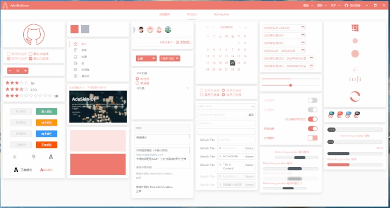

### 1.2 动态修改主题色

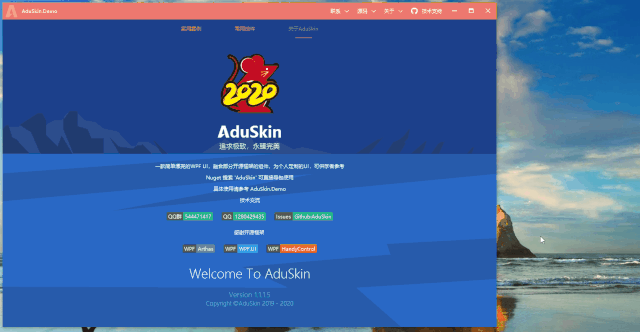

### 1.3 技术交流

- 作者 QQ：[1280429435](http://wpa.qq.com/msgrd?v=3&uin=1280429435&site=qq&menu=yes)

- QQ 技术交流群：[544471417](https://jq.qq.com/?_wv=1027&k=57GYQeb)

- 《AduSkin》源码：[AduSkin](https://github.com/aduskin)

## 2. 基于《AduSkin》控件库衍生的 Case 案例

### 2.1 AduShopping

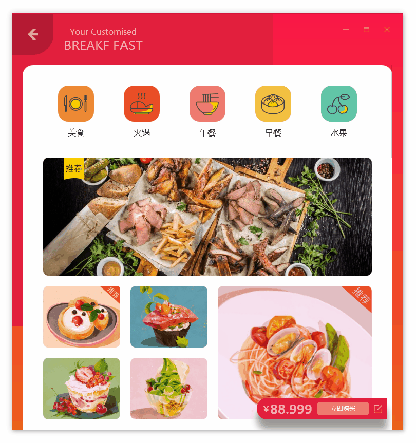

### 2.2 AduChat

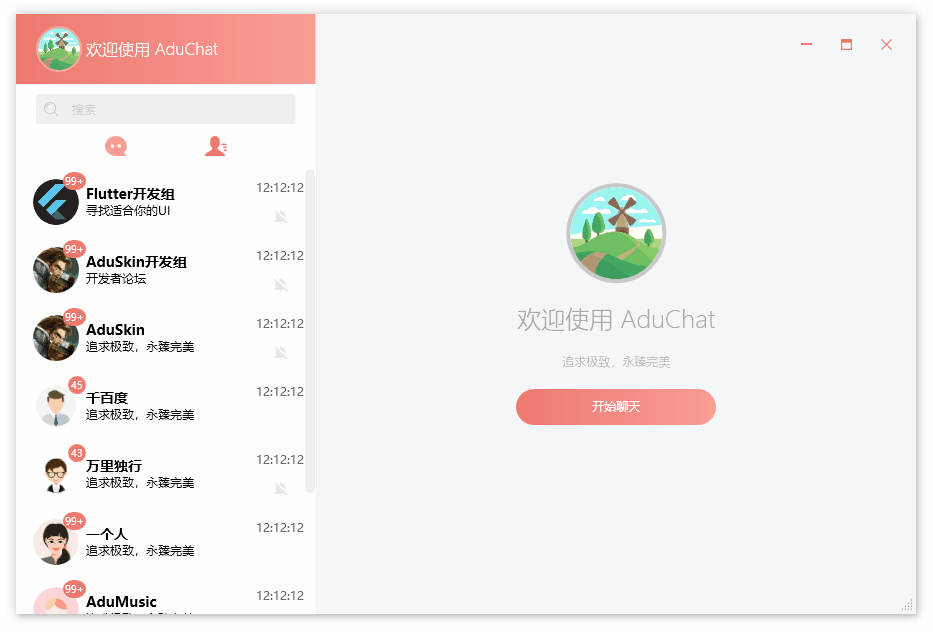

### 2.3 心理 FM

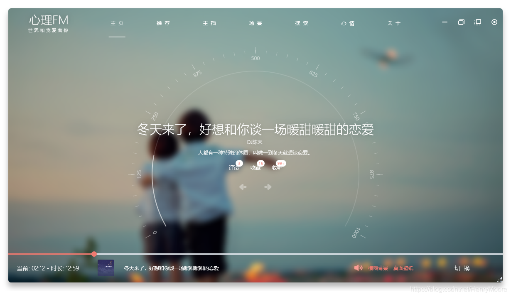

### 2.4 SuperEvil

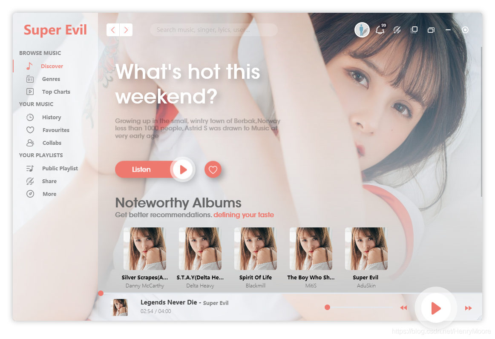

### 2.5 HttpTool

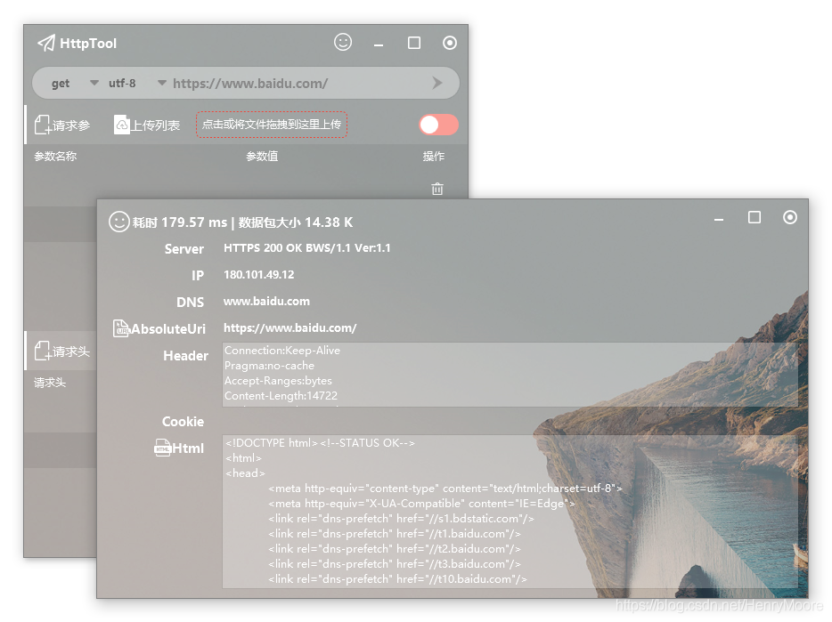

## 3. 《AduSkin》的特色控件组合案例

现有 13 个控件组合案例，见下图左侧案例菜单：

站长选择部分进行图片录制介绍：

### 3.1 Win10 菜单

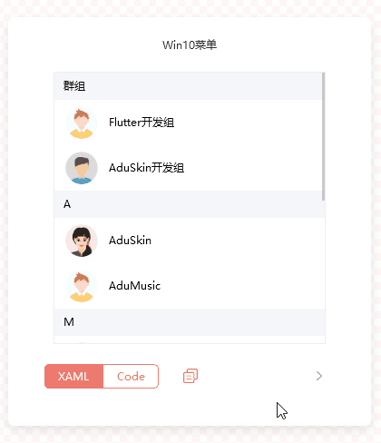

### 3.2 导航容器

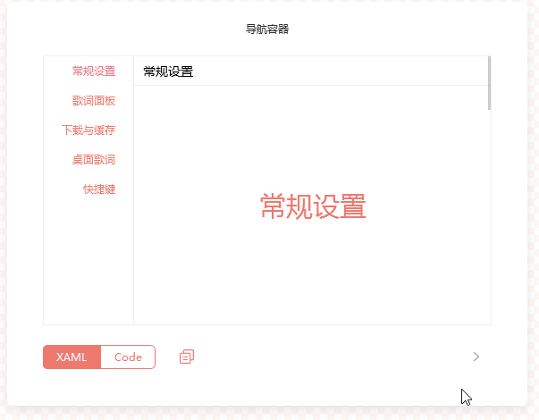

### 3.3 多功能 Tab

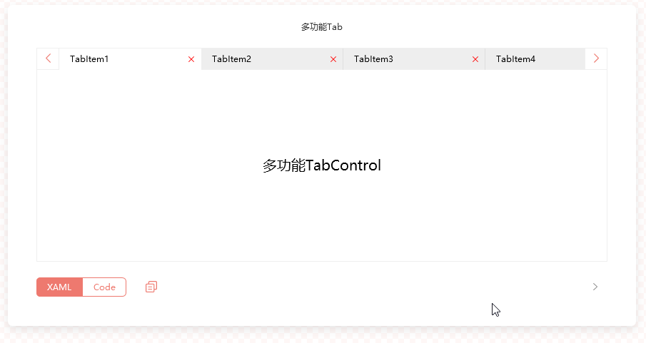

### 3.4 过渡容器

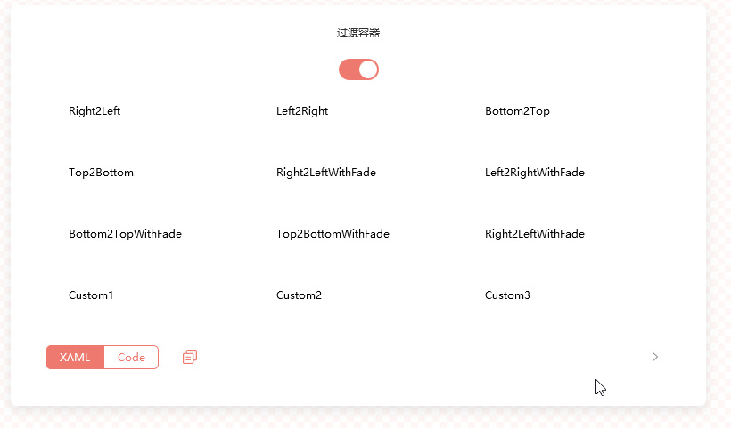

### 3.5 轮播容器

代码中可设置播放时间间隔。

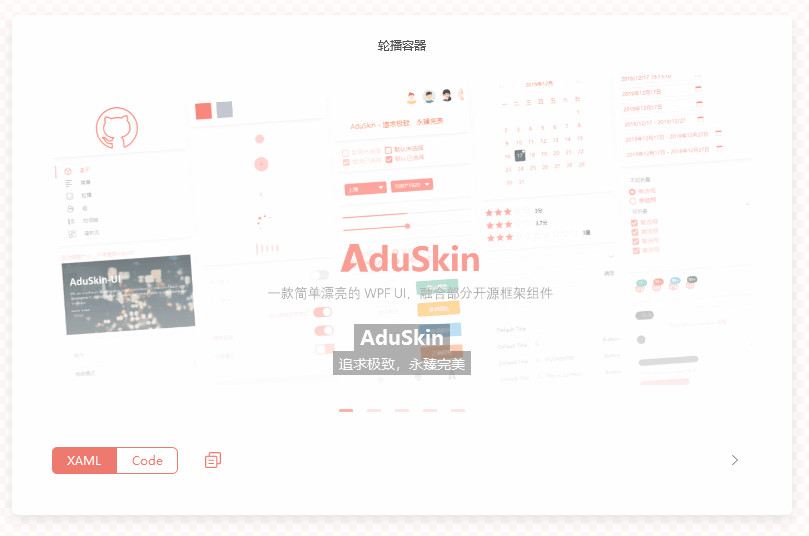

### 3.6 时间轴

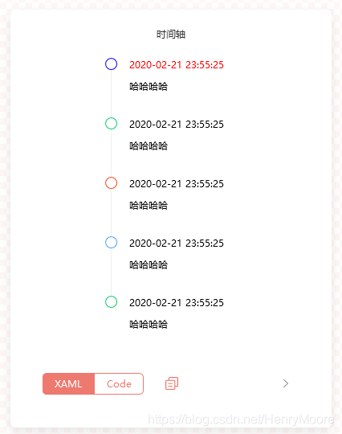

### 3.7 视频控件

### 3.8 树形菜单

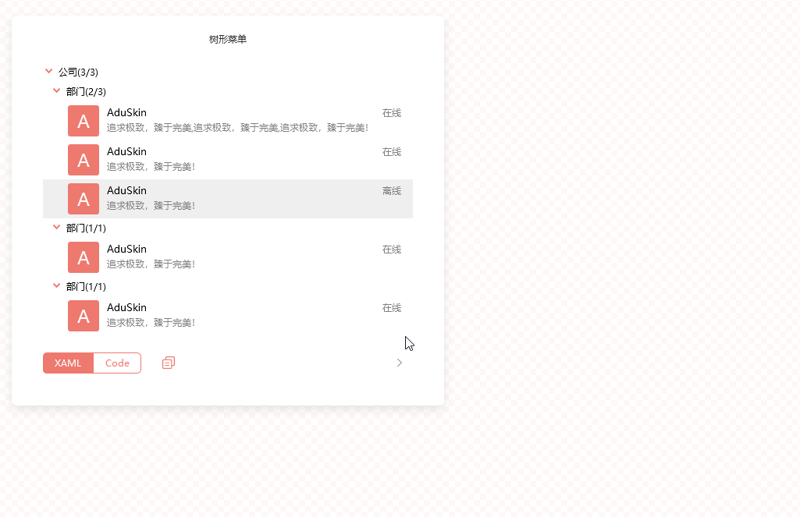

### 3.9 数据列表

封装了分页控件

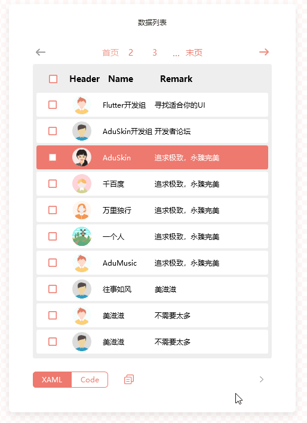

### 3.10 右侧弹窗

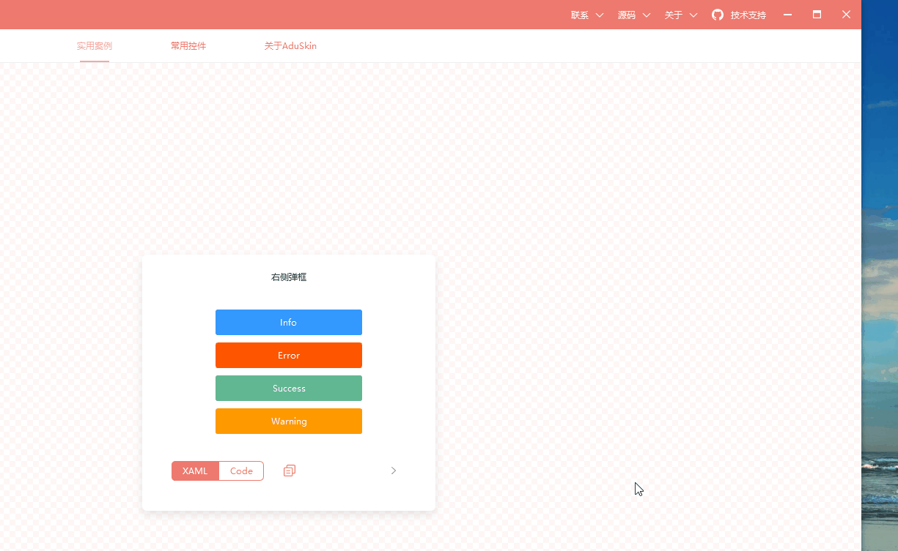

### 3.11 右键菜单

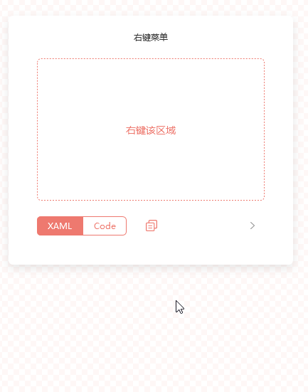

## 4. 写在最后的话

下载源码后，需要将视频解析库 “libvlc.7z” 解压到 Demo 输出目录，视频播放功能才能正常使用。

欢迎使用《AduSkin》控件库，在控件使用过程中有什么问题，可添加作者 QQ 号或 QQ 技术交流群交流。

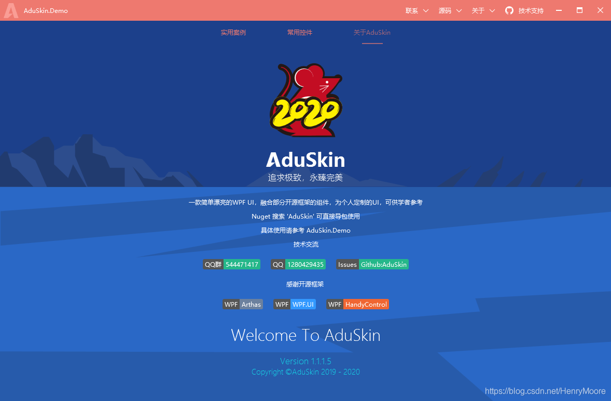
