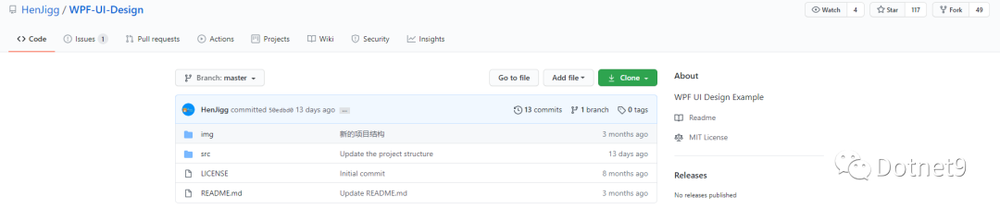
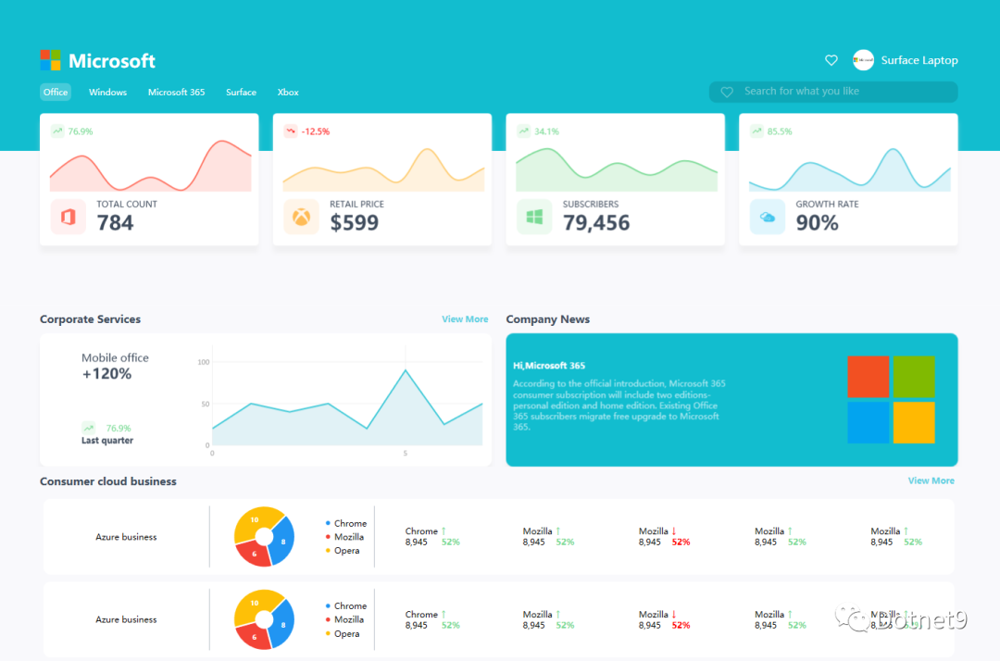
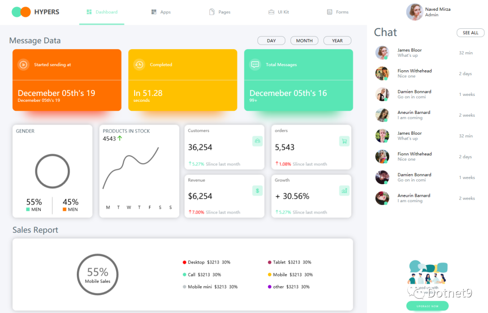
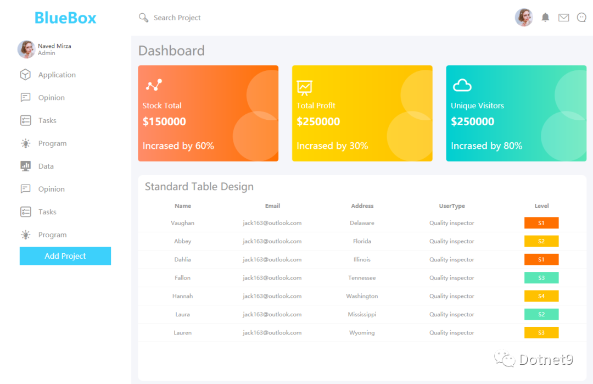
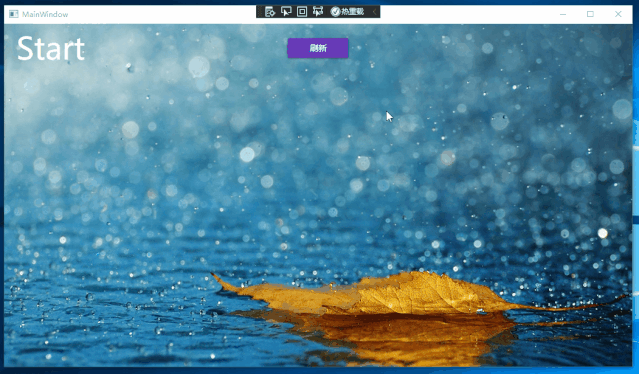
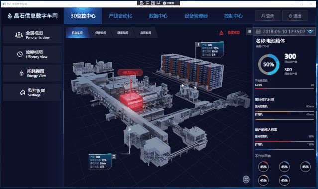
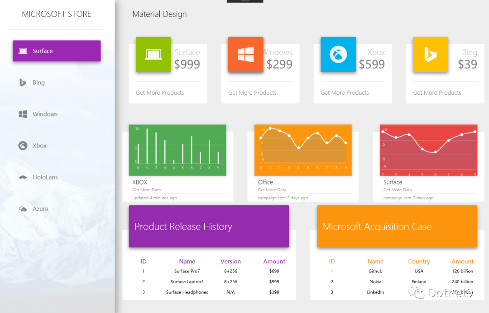

GitHub 仓库信息

- github 仓库地址：https://github.com/HenJigg/WPF-UI-Design
- bilibili 视频地址：https://space.bilibili.com/32497462

根据网友分享的一篇博文，找到的这个开源项目。这个开源项目有 8 个界面设计，效果都还不错，可以作为 WPF 开发时的一个参考。

如果你感兴趣，可以根据上面的 github 仓库地址，添加 star、下载运行，另外作者也在 bilibili 上录制了不少 wpf 学习视频，免费、中文讲解的哦。

下面是 8 个界面设计截图，希望有你喜欢的一款：

