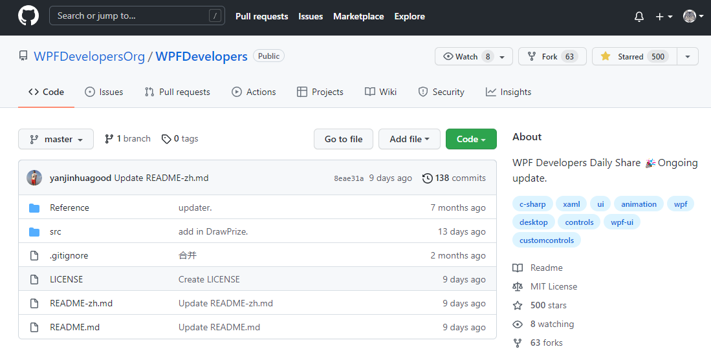

这是一个 WPF 自定义控件开源项目，里面的一些控件很有意思，下面的效果展示直接抄的作者 GitHub Read，文末有仓库地址，我们先看看部分自定义控件效果：

### DrawPrize（WPF 实现大转盘抽奖）

### DesktopPlayVideo（WPF 实现动态 Windows 桌面壁纸）

### CropControl（WPF 实现图片切成九宫格控件）

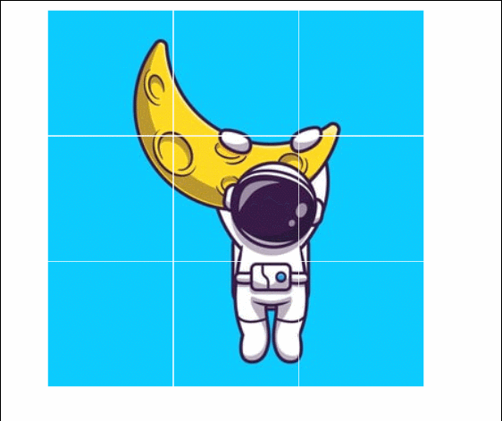

### NumberCard（WPF 实现 3D 翻转倒计时控件）

### CountdownTimer（倒计时动画）

### SpeedRockets（WPF 实现加速火箭）

### SnowCanvas（WPF 实现圣诞树雪花）

### WPFBreatheLight（WPF 实现呼吸灯）

### Thermometer（温度计）

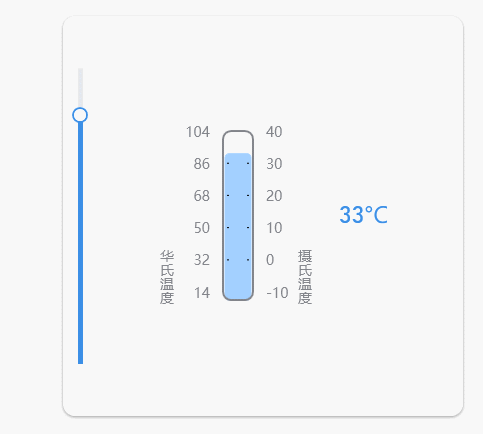

### RingLoading（酷酷的等待）

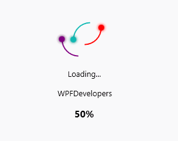

### RoundPicker（圆选择器）

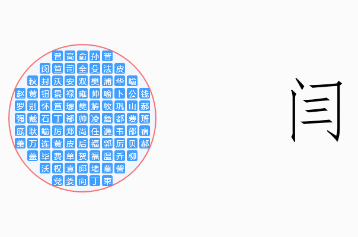

### LogoAnimation（登录动画）

### LineChart（折线图）

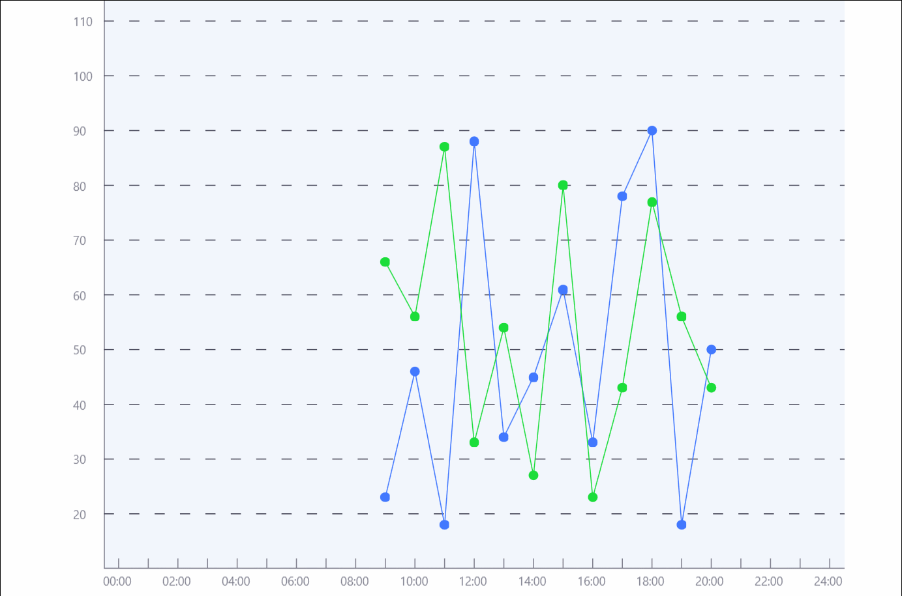

### MetroWindow（窗体）

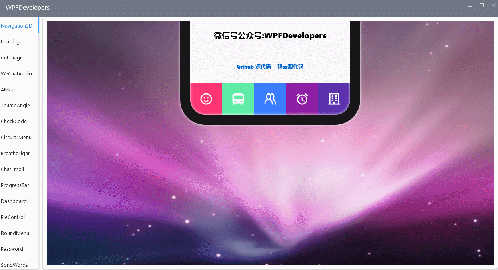

### RainbowButtons（彩虹按钮）

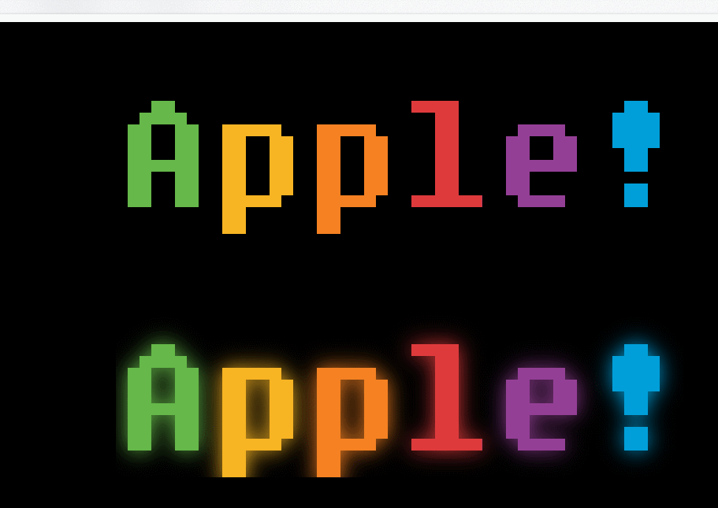

### Ruler（刻度尺）

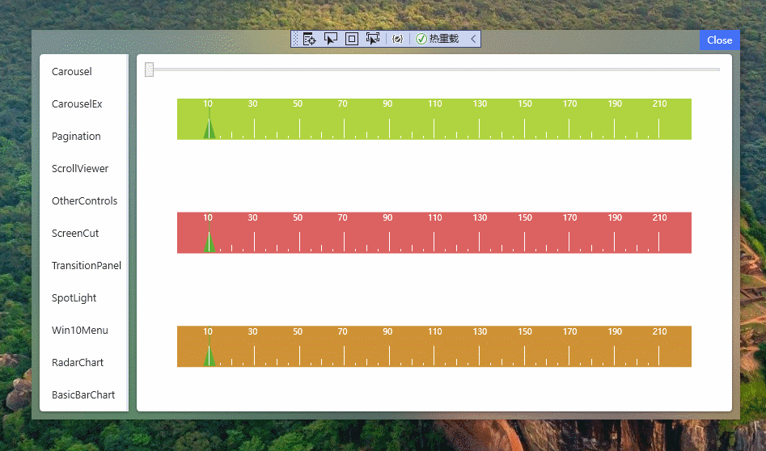

### ZooSemy（拟物旋转按钮）

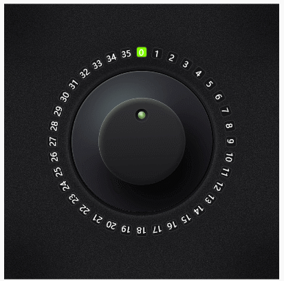

### BasicBarChart（统计图）

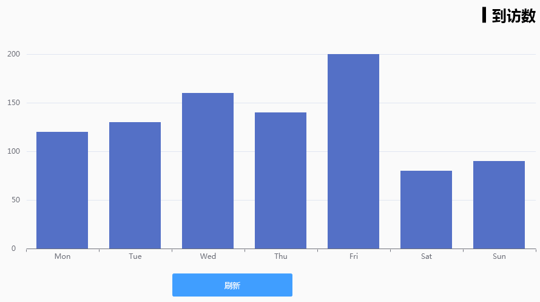

### RadarChart（雷达图）

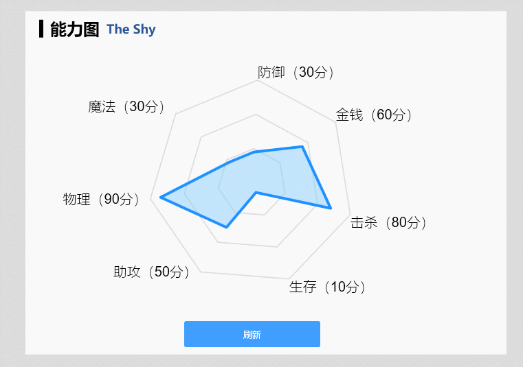

### Win10Menu（Win10 菜单）

### SpotLight（聚光灯）

### TransitionPanel（过渡面板）

### ScreenCut （截屏）

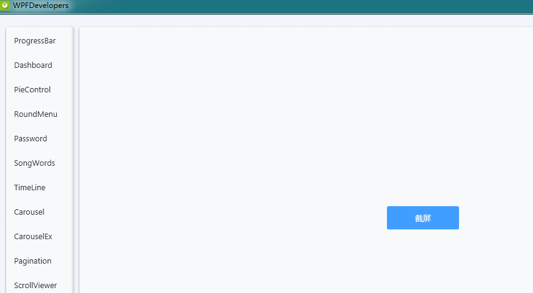

### OtherControl （火炬）

### EmphasizerCarousel （轮播图二）

### Carousel （轮播图）

### ScrollViewerAnimation （滚动条带动画）

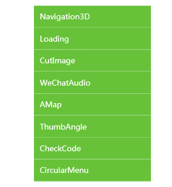

### RollLoading （等待动画）

### CycleLoading （等待动画）

### Pagination （分页）

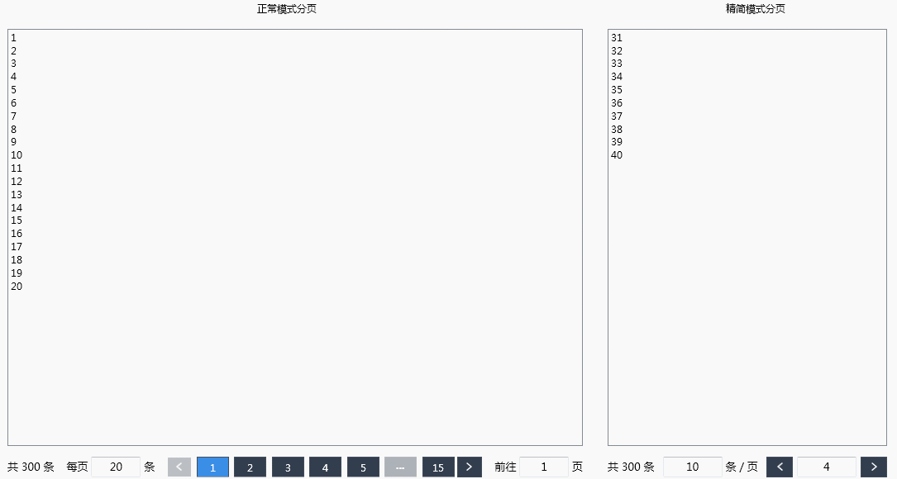

### TaskbarItemInfo （窗体任务栏角徽）

### BallLoading （等待动画）

### WpfPieControl（WPF 实现统计图（饼图仿 LiveCharts））

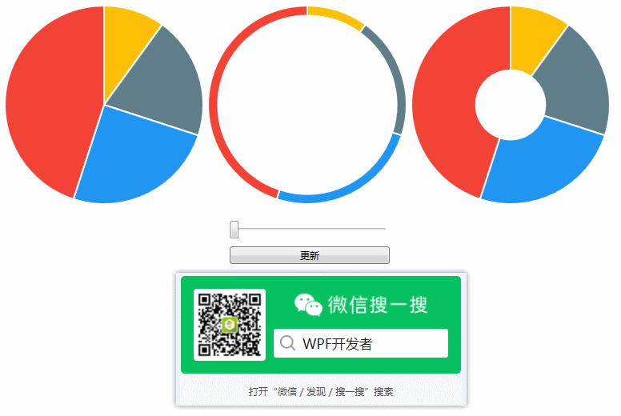

### WpfDashboard（WPF 实现仪表盘（刻度跟随进度））

### WpfTimeLineControl（WPF 实现时间轴（仿 Gitee））

### WpfCircularProgressBar（WPF 实现环（圆）形进度条）

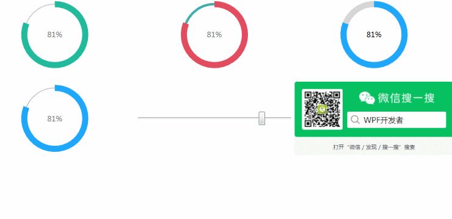

### WpfCircularMenu（WPF 实现环（圆）形菜单）

### WpfPasswrod（WPF 实现密文与密文切换）

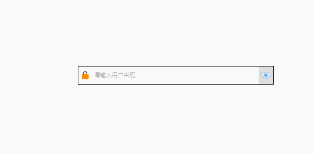

### WpfChatEmojiText（WPF 实现聊天 Emoji+文本）

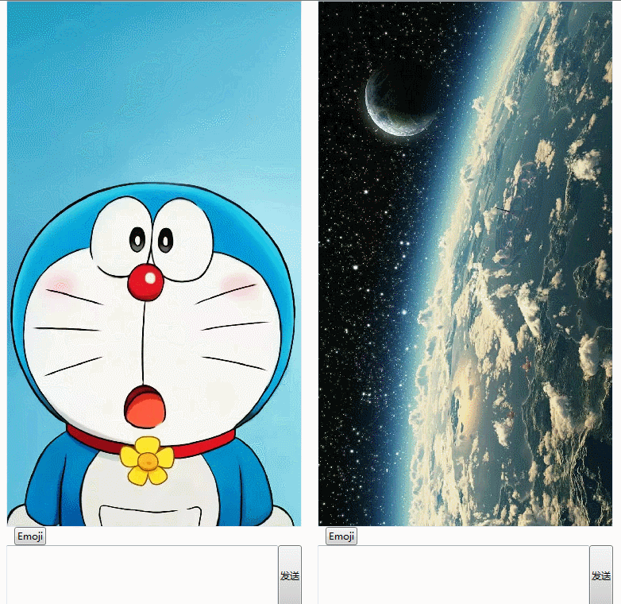

### WPFSongWords（WPF 实现歌词动画）

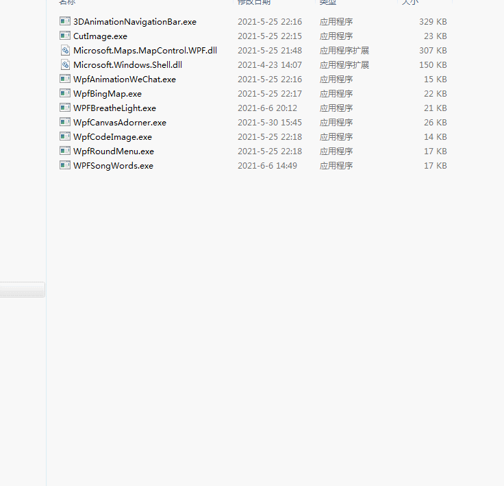

### WpfCanvasAdorner（WPF 实现旋转控件并修改宽高）

### WpfBingMap（WPF 使用 MapControl 加载高德地图）

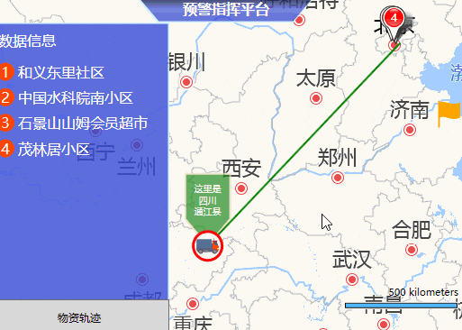

### 3DAnimationNavigationBar（WPF 实现 3D 菜单动画）

### WpfRoundMenu（WPF 实现圆形菜单）

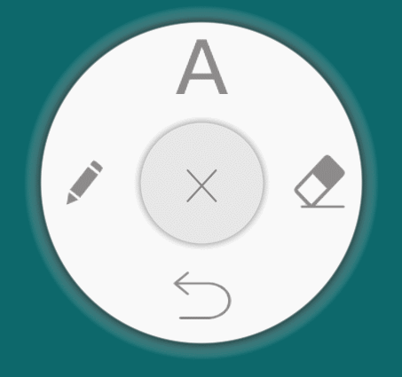

### WPFCheckCode（WPF 使用 DrawingVisual 绘制验证码）

### CutImageSolution（WPF 实现用户头像裁剪）

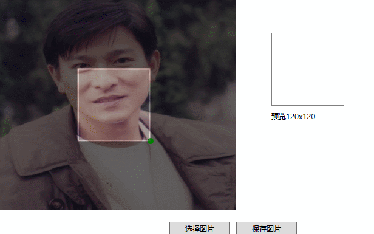

### WpfAnimationWeChat（WPF 使用图片实现微信语音播放动画）

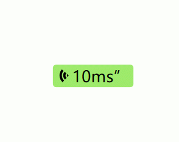

### 结束

仓库地址：

- GitHub [https://github.com/WPFDevelopersOrg](https://github.com/WPFDevelopersOrg)
- 码云 [https://gitee.com/WPFDevelopersOrg](https://gitee.com/WPFDevelopersOrg)
- 基础控件 [https://github.com/WPFDevelopersOrg/WPFDevelopers.Minimal](https://github.com/WPFDevelopersOrg/WPFDevelopers.Minimal)

> 此项目包含了 微信公众号 《 WPF 开发者》 日常开发分享，作者每完成一个自定义控件就会在该公众号发布，欢迎订阅，实时了解作者最新作品，欢迎 Star。
>
> 运行环境 Visual Studio 2019，dotNet Framework 4.0 SDK

