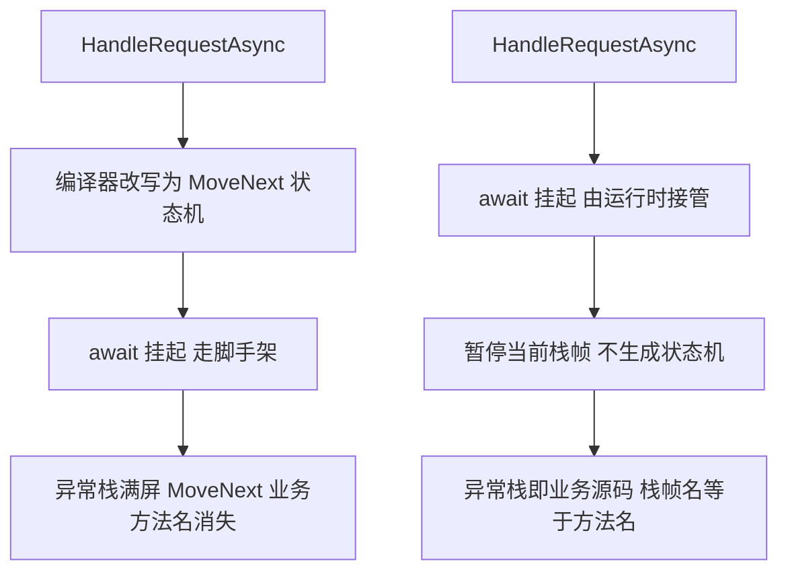

昨晚（11 月 10 日），微软在官方博客放出了 .NET 11 正式版。这篇文章原文很长，我把它啃下来，挑对我们写代码真正有影响的部分，按自己的理解重新讲一遍。除发布博文外，还对照了 Microsoft Learn 的官方清单和几篇开发者评述，引用处均标了出处。建议对照着看。


## 1. 升级前必须知道的三件事

1. **.NET 11 是 STS（标准支持期）版本**，支持 18 个月。想一步到位少折腾的，继续留在 .NET 10（LTS，支持到 2028 年）。支持政策详见[官方支持页](https://dotnet.microsoft.com/platform/support/policy/dotnet-core)。
2. **.NET 8 和 .NET 9 昨天同时停止支持**——官方发布博文的升级指引原文："*NET 8 and .NET 9 reach end of support on November 10, 2026*"（见该文 Upgrading from .NET 8 or .NET 9 一节，也可查 [.NET 支持政策页](https://dotnet.microsoft.com/platform/support/policy/dotnet-core)）。还在生产环境跑这两个版本的朋友，升级该提上日程了。
3. 最低 CPU 指令集要求有调整（官方原文只点了这一句、细节在清单里），老机器部署前先看一眼[官方的破坏性变更清单](https://learn.microsoft.com/dotnet/core/compatibility/11)。

下面按"语言 → 运行时 → AI → 库 → Web → 桌面"的顺序讲。

## 2. C# 15：这次终于有了联合类型

> 出处：[What's new in C# 15（Microsoft Learn）](https://learn.microsoft.com/dotnet/csharp/whats-new/csharp-15)、[Explore union types in C# 15（.NET 官方博客）](https://devblogs.microsoft.com/dotnet/csharp-15-union-types)

### 2.1 联合类型：最有分量的一项

以前我们表达"这个值要么是 A 要么是 B"，得用一个基类加一堆子类，或者干脆上 `OneOf` 这类第三方库。现在语言原生支持了：

```csharp
ProductLookup result = new Product(42, "Mechanical keyboard");

string message = result switch
{
    Product product => $"Found {product.Name}",
    ProductNotFound missing => $"No product with ID {missing.Id}",
};

Console.WriteLine(message);

public sealed record Product(int Id, string Name);
public sealed record ProductNotFound(int Id);
public union ProductLookup(Product, ProductNotFound);
```

`public union ProductLookup(Product, ProductNotFound)` 这一行声明了一个联合类型：值只能是括号里列出的这几种。配对出现的是 switch 表达式的**穷尽性检查**——忘了处理任何一种情况，编译器直接报错，不用等运行时炸了才发现。

写过业务代码的人都懂，"查询结果要么是数据要么是未找到"这种模型以前要绕多远，现在一行搞定。函数式语言玩了多年的东西，C# 终于跟上了。

### 2.2 封闭继承层级与封闭枚举

**封闭继承层级**（closed hierarchies）：`public closed record class GateState;` 这样声明后，类隐式变为抽象，只允许本程序集内的类型直接继承它。编译器由此能确认 switch 覆盖了所有情况、不再需要 default 分支——外部程序集塞不进来奇奇怪怪的子类打断你的模式匹配。

还有个和它配套的**封闭枚举**（closed enum）：`closed enum Color { Red, Green, Blue }` 之后，这个枚举不能通过强转塞进声明之外的值——普通枚举一直有这个口子，现在堵上了。它同样参与穷尽性检查：switch 把三个成员列全就不需要 discard 分支。

### 2.3 集合表达式带构造参数

```csharp
HashSet<string> names =
    [with(StringComparer.OrdinalIgnoreCase), "Alice", "ALICE", "Bob"];

Console.WriteLine(names.Count); // 2，忽略大小写去重
```

`with(...)` 里传的是集合构造参数（容量、比较器都行），以前这种写法得拆成两步：先建 `HashSet` 再逐个 Add。现在一行，而且比较器在集合表达式创建时就传进去了。给 `List` 预留容量也一样：`List<string> subscribers = [with(capacity: names.Length * 2), .. names];`

### 2.4 其他语言新特性

- `break`/`continue` 可以带标签：`break label;` 直接跳出指定的嵌套循环，标签写在循环结构上，labeled break 还能作用于 switch；
- 扩展索引器：扩展块里可以给没有索引器的类型声明 `numbers[2]` 这样的方括号语法，替代 `ElementAt`；
- 原生互操作的 C 风格联合换成了 `[ExtendedLayout(ExtendedLayoutKind.CUnion)]`，不用再逐字段写 `[FieldOffset(0)]`；
- 集合表达式可以作为参数传递。

内存安全相关的工作还在预览阶段，正式版没开。F# 11 主要降低了编译器内存占用，加了有界并发异步，自定义构建器的 Runtime Async 进了预览。

## 3. 运行时与 SDK：启动更快，异步更干净

> 出处：[What's new in the .NET 11 runtime / SDK（Microsoft Learn）](https://learn.microsoft.com/en-us/dotnet/core/whats-new/dotnet-11/overview)

### 3.1 Native AOT 命令行宿主默认启用

.NET 11 的命令行工具默认跑在 Native AOT 宿主上（`help`、版本查询这类命令甚至不需要启动托管 CLI），配合 **MSBuild 常驻热服务**——原文说它"在 CLI 调用之间保持热态，减少重复启动工作"。日常开发的体感就是改完代码重新编译，等待时间变短了。

### 3.2 Runtime Async：把异步挂起搬进运行时

这是个面向未来的大动作。现在 C# 的 async/await 由编译器生成状态机——每个 async 方法被改写成一个大 `MoveNext` 状态机类，挂起/恢复全在这套编译器生成的脚手架里跳。调试时调用栈里全是 `MoveNext`，看不出业务调用路径：

```text
// 编译器状态机（现状）：业务方法名全部消失
at MyApp.Service.ProcessOrderAsync()        ← 实为 MoveNext 脚手架
at System.Runtime.CompilerServices.AsyncTaskMethodBuilder`1.Start[TStateMachine](...)
at MyApp.Service.ProcessOrderAsync()
at System.Runtime.CompilerServices.AsyncTaskMethodBuilder`1.Start[TStateMachine](...)
at MyApp.Controller.HandleRequestAsync()
...
```

Runtime Async 把挂起逻辑下沉到运行时，挂起时的调用栈是**真实的业务调用栈**：

```text
// Runtime Async（.NET 11 预览）：栈即业务代码
at MyApp.Service.ProcessOrderAsync()        ← await 挂起点，栈名与源码一致
at MyApp.Service.FlushQueueAsync()
at MyApp.Controller.HandleRequestAsync()
at MyApp.Program.Main()
...
```

排查生产问题的体验完全不同——以前要在 `MoveNext` 脚手架里对照行号猜原始方法，现在栈帧即源码。

两者的差异用一张流程对比图看更直白（上：现状编译器状态机；下：Runtime Async）：



对比要点：上排所有业务方法都要经过「编译器改写 → 状态机脚手架」这一步，栈帧名随之丢失；下排挂起由运行时直接接管，方法栈原样保留。

面向 `net11.0` 的项目需要显式打开（不再要求 `EnablePreviewFeatures`）：

```xml
<PropertyGroup>
  <Features>$(Features);runtime-async=on</Features>
</PropertyGroup>
```

Runtime Async 自身这版还在继续提速：同步返回 Task 的方法有了运行时异步专用版 JIT 编译、无环境状态时异步续延不再捕获 `ExecutionContext`、挂起点做了尾合并以缩小生成代码体积。

我的建议：新项目可以开起来试试，感受一下新的栈；生产项目等正式特性。细节见 [Runtime Async 文档](https://learn.microsoft.com/dotnet/core/whats-new/dotnet-11/runtime#runtime-async)。

### 3.3 JIT 与运行时其他改进

- 冗余边界检查更少、去虚化更激进、switch 表达式与 `SequenceEqual` 常量折叠；Native AOT 用共享分发辅助实现更快的接口调用，接口密集型工作负载吞吐提升、调用点二进制体积缩小
- `Half`/FP16 硬件内在函数（x64 与 Arm64）、Arm SVE2 内在函数、AVX-VNNI-512 向量乘加
- Linux 和 macOS（含移动平台）上进程内崩溃报告能直接写日志了——捕获托管栈与运行时状态，以前只有 Windows 有
- SIMD 新增跨通道构造与组合 API（`CreateGeometricSequence`、`Zip`、`Unzip`、`Concat` 系列）

### 3.4 SDK 开发体验

- `dotnet test` 支持 `--timeout`、失败上限、实时显示在跑的测试，多了 Android/iOS/macOS/Mac Catalyst 测试模板；测试模板默认 xUnit v3
- `dotnet run -e` 直接从命令行传环境变量；文件型应用（file-based apps）支持 `#:include` 拆多文件、直接引用 DLL，可复用 Native AOT 构建产物
- `dotnet sln` 支持创建和编辑解决方案筛选器（`.slnf`）
- Linux/macOS 的 SDK 安装包经程序集去重变小
- 容器发布支持 `SOURCE_DATE_EPOCH` 实现可复现镜像摘要；目标清单已存在时跳过冗余层上传；优先使用平台原生本地运行时（Windows 的 `wslc`、macOS 的 `container`）
- 新的 `dotnetup` 工具链管理器（公开预览），在用户账户内安装/更新 SDK 与运行时

## 4. AI 这条线：从模板到组件全配齐

这是 .NET 11 投入最重的方向，对做 AI 应用的团队几乎是全套补给：

**MCP 服务器模板进了 SDK**，一条命令起个项目骨架：

```bash
dotnet new mcpserver -o MyMcpServer
```

Vex 的 MCP 支持是 10 月社区朋友提的 PR 带来的，最初落地时服务器端还得自己搭；现在官方模板直接生成，接 AI 客户端的成本又低了一截。这个模板面向的是独立的 MCP 服务器项目——像 Vex、Vox 这种把 MCP 服务内嵌在桌面应用里跑的场景，可以直接用模板背后的官方 C# MCP SDK，见下面 4.1 的实战记录。

### 4.1 实战：桌面应用内嵌 MCP 服务，把自研协议层换成官方 SDK

我的两个桌面应用（Markdown 编辑器 Vex、内容仓库工具 Vox）都内嵌了本地 MCP 服务，协议层此前是各自手写的 JSON-RPC。趁这次 .NET 11 发布，我把两边都迁到了 `ModelContextProtocol.AspNetCore`（2.4.0）：工具确认、调用审计、授权范围这些业务逻辑留在自己的引擎层不动，SDK 只接管协议与传输——进程内 Kestrel 监听 127.0.0.1，`app.MapMcp("/mcp")` 一行挂上端点，握手、会话分配、协议版本协商全部不用自己管。

迁移中踩到的几个点，给同样想内嵌 MCP 服务的提个醒：

- **会话模式默认是无状态**：这一版 `HttpServerTransportOptions.SessionMode` 默认 `Stateless`，服务端不分配 `Mcp-Session-Id` 响应头，依赖会话的客户端会直接懵——要显式设为 `Stateful`；
- **回包是 SSE 帧不是裸 JSON**：服务端按 Streamable HTTP 规范可以选 `text/event-stream` 回包（`event: message` + `data: {...}`），自写的测试客户端、stdio 桥接脚本都要按帧解；
- **Native AOT 直接能过**：两个应用都是 NativeAOT 发布，ASP.NET Core 的 minimal hosting 加 SDK 顺利通过发布验证；唯一要注意的是自己桥接代码里别用反射版 JSON API（如 `JsonSerializer.SerializeToNode`），换成 `GetRawText()` 解析这类 AOT 友好的写法；
- **跟着编译器走**：`McpServerOptions` 的 `Instructions` 这版叫 `ServerInstructions`，handler 委托对返回类型的可空性也查得很严——SDK 沿 API 还在快速收敛，编译器报什么改什么。

一句话总结：自研的 MCP 协议层可以退休了，业务引擎层才是真正值得自己维护的部分。

回到主线：模板和 SDK 只是地基，往上走是三层：

1. **Microsoft.Extensions.AI**：`IChatClient`、`IEmbeddingGenerator` 这些标准抽象，换模型供应商不用改业务代码；
2. **Microsoft Agent Framework（MAF）**：多智能体编排；
3. **Blazor AI 组件（实验性）**：带 AG-UI 协议集成，做对话式界面（agentic UI）可以少写很多前端胶水代码。

开发工具侧还有 .NET Skills、实验性的 MAUI DevFlow 工具包、以及 .NET Upgrade 画布（GitHub Copilot 升级会话的可视化视图）。总之微软的判断很明确：.NET 开发者做 AI 应用，应该是"选配置"而不是"造轮子"。

## 5. 基础库：几个马上能用上的

> 出处：[What's new in .NET 11 libraries（Microsoft Learn）](https://learn.microsoft.com/en-us/dotnet/core/whats-new/dotnet-11/overview)

### 5.1 压缩与流

- **Zstandard 压缩**进了 BCL（`System.IO.Compression`），配套一批基于 span 的压缩 API；ZIP 归档读取支持 CRC32 校验，无流的 Deflate/ZLib/GZip 编解码器加了 `Reset()` 复用
- **内存流适配器**家族：`ReadOnlyMemoryStream`、`WritableMemoryStream`、`ReadOnlySequenceStream`、`StringStream`——直接把内存块当流用，不再需要先拷贝进 `MemoryStream`

### 5.2 System.Text.Json

支持 C# 联合类型和 F# 可辨识联合的序列化；新增 JSON Lines 输出（每行一个 JSON，流式处理日志和大数据集很顺手）；多态与源生成扩展、新的命名与忽略控制、内置数字转换器与集合契约。

### 5.3 LINQ 与进程 API

- **LINQ 补了 `FullJoin`**：左右两边的未匹配元素都保留，以前要靠左右两个 `GroupJoin` 拼半天；`Join`/`GroupJoin` 还多了返回元组的重载，`Enumerable`/`Queryable`/`AsyncEnumerable` 全覆盖
- **一次性进程执行 API**：跑个外部命令不用再管理 `Process` 生命周期——这代 `Process` API 扩充得很全：run-and-capture 辅助、fire-and-forget 启动、`StartSuspended` 挂起启动、`TryGetProcessById` 安全查找、`Signal(PosixSignal)` 信号发送，配合新的 `ProcessExitStatus` 检查退出方式

### 5.4 数值与其他

- IEEE 754 十进制浮点 `Decimal32`/`Decimal64`/`Decimal128`，泛型 `Complex<T>`，`Random` 泛型重载（`NextInteger<T>`、`NextBinaryFloat<T>`）
- 小而美：`EqualityComparer<T>.Create` 工厂方法（从 key selector 直接造比较器）、`MemoryCache` 内置 OpenTelemetry 指标、跨平台类型化 DNS 解析（`DnsResolver`）、`QuicStream.Priority` HTTP/3 流优先级、增量式 CBOR 读取、X25519 密钥交换与实验性的后量子密码 API

## 6. EF Core 11：查询更聪明，还有向量检索

EF Core 11 需要 .NET 11 才能跑。三个重点：

1. **生成的 SQL 里无用 JOIN 更少了**——翻译同样的 LINQ 查询，产出的 SQL 更干净；
2. `FullJoin` 也能翻译到 SQL 了；
3. 实验性的 **SQL Server 向量索引与相似度检索**，做 RAG 类应用可以直接在数据库层做向量搜索，不用额外引入专门的向量库。

## 7. ASP.NET Core：OpenAPI 3.2 成为默认

- **OpenAPI 3.2 默认开启**——注意这一点可能影响现有的客户端代码生成器，升级前确认一下（破坏性变更见[此清单](https://learn.microsoft.com/dotnet/core/compatibility/11)）
- MVC 控制器/动作支持 `[ShortCircuit]` 特性：路由匹配后立即执行端点、跳过后续中间件——性能好，但如果后面还排着认证或 CORS 中间件就要小心
- Minimal API 的模型验证支持异步（`AsyncValidationAttribute`、`IAsyncValidatableObject`，经 `AddValidation()` 注册，处理执行前完成校验）；`DataAnnotations` 也配了 `Validator.ValidateObjectAsync`
- 响应压缩与请求解压内置 Zstandard 提供程序（可配质量等级，客户端需声明支持 zstd）
- 输出缓存策略支持运行时动态解析（`IOutputCachePolicyProvider`），不再只能启动时定死
- SignalR 支持认证令牌刷新，长连接不再中途掉权限
- Blazor 新增 `CacheView`（组件输出缓存）；浏览器标签页不活跃时电路自动暂停，省服务器资源

## 8. 桌面与移动

**MAUI 这边最大的变化：CoreCLR 成为默认运行时**（以前是 Mono 系），XAML 热重载进了预览，XAML 命名空间支持隐式导入。注意 [MAUI Compatibility 包不再随包发布](https://learn.microsoft.com/dotnet/core/compatibility/11)，依赖它的老项目升级前要先迁移。

**WinForms** 提供了选择开启的现代视觉样式；**WPF** 以可靠性修复为主。

## 9. 动手试试

.NET 11 在[官方下载页](https://dotnet.microsoft.com/zh-cn/download)即可直接下载，Windows/Linux/macOS 的 SDK 与运行时都有：

```bash
dotnet new console -n HelloDotnet11 -f net11.0
dotnet run --project HelloDotnet11
```

升级现有项目把 `TargetFramework` 改成 `net11.0` 即可，但先过一遍[官方破坏性变更清单](https://learn.microsoft.com/dotnet/core/compatibility/11)，特别是 CPU 指令集要求、MAUI 兼容包移除和 OpenAPI 默认版本这三处。

## 10. 我的看法

.NET 11 的主线很清晰：**语言层面补上类型系统的表达力（联合类型），运行时层面为调试和性能铺路（Runtime Async、AOT 宿主），生态层面全力押注 AI 开发体验**。STS 的定位也说明这是个"过渡吸收"版本——新东西先落地收反馈，成熟后进下一个 LTS。

对我们这些做桌面应用的，这版可以直接感知到的是 SDK 提速和新的内存流 API；联合类型对业务代码是实打实的减负。至于升级时机：新项目上 11 没问题，生产项目如果不是赶 .NET 8/9 停支持的窗口，等下一个 LTS 更稳。

原文还提到一个数字：.NET 11 是超过 7000 名贡献者的作品，NuGet 上已有 58.9 万+ 独立包、下载量超过 1.1 万亿次。生态的体量摆在这里，选择 .NET 肯定不亏。


## 11. 参考

本文特性细节交叉核对自以下来源：

1. [Announcing .NET 11（微软官方发布博文）](https://devblogs.microsoft.com/dotnet/announcing-dotnet-11/)——发布主线与 AI 生态部分的主要出处
2. [What's new in .NET 11（Microsoft Learn 官方清单）](https://learn.microsoft.com/en-us/dotnet/core/whats-new/dotnet-11/overview)——运行时、基础库、SDK 各节的逐项核对出处
3. [.NET 11 破坏性变更清单（Microsoft Learn）](https://learn.microsoft.com/dotnet/core/compatibility/11)——升级须知三条的出处
4. [What's new in C# 15（Microsoft Learn）](https://learn.microsoft.com/dotnet/csharp/whats-new/csharp-15)与[Explore union types in C# 15（.NET 官方博客）](https://devblogs.microsoft.com/dotnet/csharp-15-union-types)——第 2 节语言特性与代码示例的出处
5. [The Best 11 New Features in .NET 11 and C# 15（Ed Andersen）](https://www.edandersen.com/p/the-best-11-new-features-in-net-11)——`with(capacity:)`、`[ShortCircuit]`、封闭枚举等细节与 10 vs 11 对照示例的参考来源

---

> 本文在 Vox（基于 .NET 与 Avalonia 的开源 Markdown 编辑器）中写作完成。
