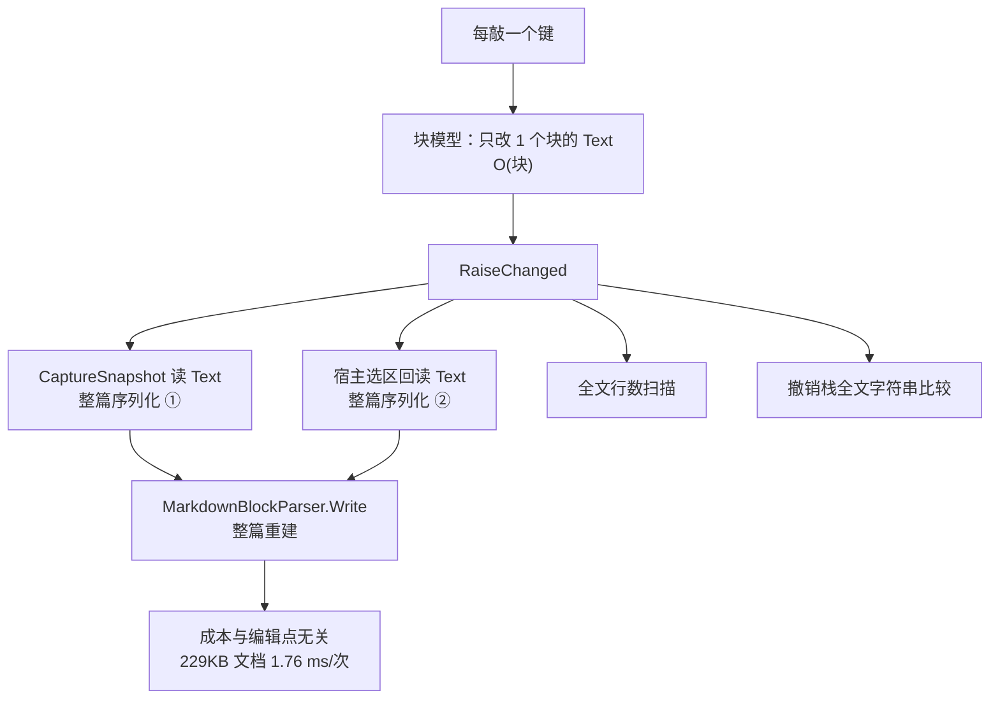
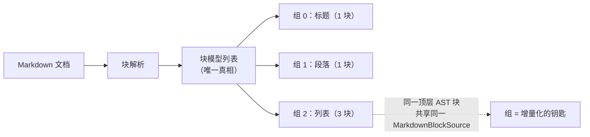
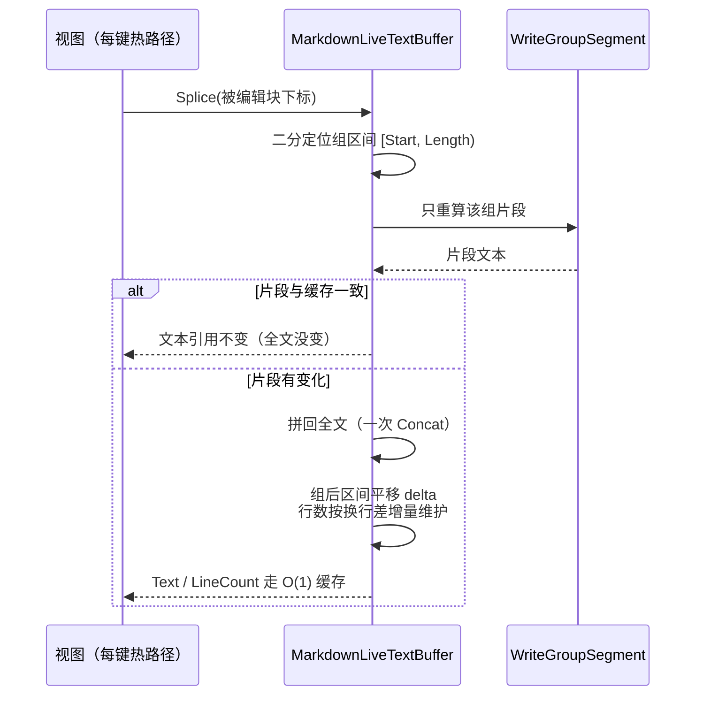
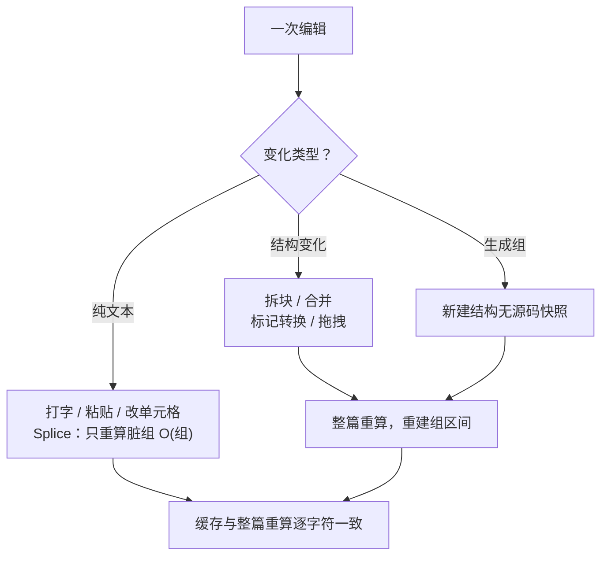
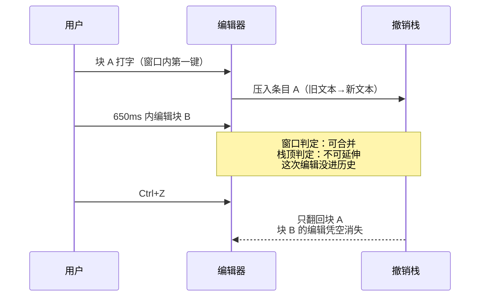

---
title: "Markdown 编辑器每键 22× 提速：脏块回写替代全文序列化"
slug: vex-editor-dirty-block-writeback
description: "长文档打字卡的根因不在解析端，在回写端——每键把整篇 Markdown 从块模型序列化两遍。改成只重算被编辑的脏块片段拼回缓存全文，229KB 文档每键 1.76ms 降到 0.08ms，内存分配降 14×"
date: 2026-11-22 10:30:00
lastmod: 2026-11-22 14:10:00
cover: 2026/11/vex-editor-dirty-block-writeback-cover.svg
categories:
  - .NET
  - Vex
tags:
  - Avalonia
  - Markdown
  - 性能优化
  - C#
draft: true
---

Vex 的即时编辑模式里，几百段的文档连续打字，跟手程度肉眼可见地往下掉。当时的基线测量，输入延迟 P95 在 45ms 上下，长文档峰值能摸到 186ms——键盘敲下去，字要迟一会儿才出现。

第一反应是去优化解析：Markdown 编辑器卡，谁不先怀疑解析器。实测下来发现方向反了——**整篇文档解析只发生在载入和结构变化时，每键热路径上根本没有解析**。每键只做一件事：改一个块模型的 `Text` 属性。

真正每键都在跑的，是它的反面——**把块模型序列化回 Markdown 文本**。这篇就讲这一刀怎么定位、怎么砍、砍完之后压测又抓出了什么。

## 瓶颈不在解析端，在回写端

旧实现里，全文文本挂在视图的 `Text` 属性上：

```csharp
public string Text => MarkdownBlockParser.Write(_models);
```

读一次 `Text`，就把整篇文档从头到尾 StringBuilder 拷一遍。而每键路径上读它的不止一处，完整账单见下图：



229KB 文档一次 `Write` 1.76ms，每键两次就是 3.5ms 起步，再叠行数扫描和撤销栈的比较。这些成本有个共同特征：**不管改的是 3 个字还是 30 个字，全文都要从头算一遍**——和编辑点在哪、改了多少，毫无关系。

瓶颈找到了：不在解析端，在回写端。

## 组：块模型的天然分片

动手之前，先看块模型的分组结构。解析器在载入时会为每个顶层 AST 块记一份源码快照（`MarkdownBlockSource`：块前空白、规范文本、行尾风格），**同一个顶层块拆出的连续块共享同一份快照**——一个列表的三项、一段引用的几行，天然是一组：



组就是增量化程度的标尺。序列化其实是按组进行的：未变的组直接吐 `source.Markdown` 原文（快路径），只有内容变了的组才重算 canonical 文本。也就是说 1.76ms 里真正必要的只有脏组那一小段，其余全是**没变的组陪跑**——整篇 StringBuilder 拷贝、分组 LINQ 分配、组间衔接。

顺着这个结构，方案就出来了：把全文缓存住，每键只重算被编辑组的片段，拼回去。前提是得知道每个组在全文里的确切位置——把 `Write` 改造成 `WriteWithSpans`，一次遍历，输出全文的同时把每组的区间记下来：

```csharp
public static (string Text, List<MarkdownGroupSpan> Spans) WriteWithSpans(
    IReadOnlyList<MarkdownBlockModel> blocks)
{
    var builder = new StringBuilder();
    var spans = new List<MarkdownGroupSpan>();
    for (var index = 0; index < blocks.Count;)
    {
        var source = blocks[index].Source;
        var first = index;
        index++; // 先无条件前进一格：Source 为 null 的块自成单块组
        while (source is not null && index < blocks.Count
            && ReferenceEquals(blocks[index].Source, source))
        {
            index++; // 引用相等 → 同组
        }

        var group = new List<MarkdownBlockModel>(index - first);
        for (var i = first; i < index; i++) group.Add(blocks[i]);
        var start = builder.Length;
        AppendGroup(builder, group, source, isLast: index == blocks.Count);
        spans.Add(new MarkdownGroupSpan(start, builder.Length - start, first, source));
    }

    return (builder.ToString(), spans);
}
```

每组拿到自己的 `[Start, Length)`，与 `Write` 的输出逐字符一致。这个"顺路记账"是整个方案的支点。

## 只重算被编辑的组

记账有了，缓存登场。`MarkdownLiveTextBuffer` 的定位很明确：**块模型列表是唯一真相，全文文本是派生缓存**。视图每键把被编辑块的下标传进来：



拼接的核心几行：

```csharp
var segment = MarkdownBlockParser.WriteGroupSegment(group, span.Source, isLast: ...);
var oldSegment = _text.Substring(span.Start, span.Length);
if (string.Equals(oldSegment, segment, StringComparison.Ordinal)) return true; // 引用不变

_text = string.Concat(_text.AsSpan(0, span.Start), segment, _text.AsSpan(span.Start + span.Length));
var delta = segment.Length - span.Length;
_spans[spanIndex] = span with { Length = segment.Length };
for (var i = spanIndex + 1; i < _spans.Count; i++)
{
    _spans[i] = _spans[i] with { Start = _spans[i].Start + delta };
}
_lineCount += segment.AsSpan().Count('\n') - oldSegment.AsSpan().Count('\n');
```

两个细节值得说。其一，片段与缓存一致时直接返回且**文本引用不变**——调用方用 `ReferenceEquals` 就能判断全文是否变化，连全文字符串比较都省了。其二，`Text` 和 `LineCount` 从此是 O(1) 的属性读，宿主选区回读的那次整篇序列化，就是这么消失的。

不是所有编辑都能走这条路。结构变化（回车拆块、退格合并、标记转换、块拖拽）会重建组区间，本来就要整篇重算；解析器新生成的结构没有源码快照（生成组），它的片段依赖前文状态，单独拼会拼错——缓冲区对生成组直接回落整篇重算，宁可整篇，不可出错：



选区映射也一并改成增量版：组后块按位移平移，组内块在旧片段窗口内局部重定位，不再每次全文 `IndexOf`。

## 等价性是底线

拼接路径和整篇重算必须逐字符一致——否则预览、撤销、保存看到的文本，就会出现只有打字才能复现的诡异差异。测试拿整篇重算当参照，把拼接结果逐场景钉死：CRLF 行尾、引用组、表格、围栏代码、任务勾选、生成组回退，33 个场景全对上；基准里也压了一条等价性断言，两条路径跑完的最终全文必须一致。

顺藤摸瓜还修了两个**预存在的保真缺陷**——不是拼接引入的，主分支一直带着：

1. 多模型组的 canonical 在成员之间插空行：编辑一个紧列表，写回就变松散列表（项与项之间多了空行）；
2. 引用内标题回写丢 `##`：`> ## 标题` 编辑后级别被吃掉。

这两个 bug 一直没人报，因为触发条件是"编辑多行列表/引用后保存"——恰好是拼接路径把 canonical 的保真性变成了每键必经的检查，它们才浮出来。

## 数据

基准 `MarkdownLiveSpliceBench`（Windows 11 x64 / .NET 11 Release，库层每键成本）：

| 文档 | 旧（每键整篇序列化） | 新（脏组拼接） | 提升 |
|---|---|---|---|
| 22KB / 400 段 / 100 键 | 0.20 ms/键，分配 68 MB | ~0.00 ms/键，分配 4 MB | 分配 17× |
| 229KB / 3000 段 / 50 键 | 1.76 ms/键，分配 303 MB | **0.08 ms/键，分配 22 MB** | **22× 提速，14× 降分配** |

注意这是库层每键成本，旧路径的真实体感还要 ×2——选区回读又序列化一次。残余成本是拼接本身的一次 O(全文) 内存拷贝（`string.Concat`）加宿主侧一次 memcmp 级比较，229KB 文档上约 0.08ms。100KB 以内的文档这部分 0.1–0.3ms，不值得上 rope；哪天真出现 MB 级单文档，再引分片文本不迟。

## 落盘之前，压测又抓出一个 bug

这篇成稿前跑了一遍验证流水：


压测抓出的这个 bug 跟性能无关，但比性能问题更狠——**跨块编辑在撤销合并窗口内被静默吞掉**。

撤销栈把 650ms / 32 字符内的连续键入合并成一组，避免每键一条历史。合并的前提是"栈顶条目可以被延伸"，而块级条目只记录单个块的前后文本，翻转只能发生在单块上——换了块就不能延伸。问题出在两个判定的接缝上：



修法是把"不能延伸"落到独立条目上：


修复连同压测入库，全量 169 个测试全绿。教训值得记一笔：**数字好看不代表行为正确**——22× 复核通过的同时，压测照样抓出一个编辑丢失级的 bug。性能验证和行为验证是两件事，缺一不可。

## 还剩什么

回写这一刀砍完后，每键热路径上最大的单项换成了排版：9.7KB 段落一次 `TextLayout` 整体重排 8ms，占每键排版成本的 98%。这一刀也落了——Avalonia 12.1.6 自带公开的 `TextRunCache` / `InvalidateFrom`，接入后同段落追加 13.27→4.48ms（3×）。行级增量重排（只重排脏行、未变行复用）需要自建行级布局引擎，留作专项。

至于回写端：O(全文) 的拼接拷贝已经压到 0.08ms 量级，除非哪天出现 MB 级单文档，否则不值得再动。

回头看，这一刀能落下来靠的不是什么高级数据结构，就是把"每键都在跑的东西"老老实实列了一遍账单。

**瓶颈不在你第一反应的地方。先测，再动手。**