10 月 3 日，我写过一篇《Vex 升级：编辑器长出 AI 的手——MCP 支持全记录》，介绍怎样让 AI 通过 MCP 读文档、改正文、操作编辑器。那时介绍的版本是 1.3.0。

现在，Vex 的代码版本已经到了 **1.23.1.0**。

这一阶段的更新集中在写作工作台本身：四种视图怎么衔接、八种布局怎么选、即时编辑与精确源码如何共存，章节导图能不能直接改结构，大纲能否可靠导航，图表和图片能不能就地修改，以及界面外观、正文排版与文件保护这些外围环节。下面按写一篇文章的顺序展开。

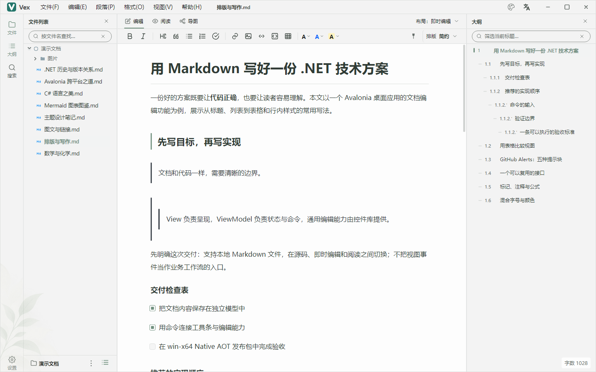

如果你第一次听说 Vex，可以先记住一句话：**它是我维护的免费开源 Markdown 桌面编辑器，基于 .NET 与 Avalonia，面向 Windows、Linux 和 macOS，文章保存在本地文件里。**

它现在的标语是：**写下想法，看见脉络。**

## 1、同一篇文章，四种看法


### 1.1、按眼前的事情，选择合适的视图


以前介绍 Vex，最容易展示的是源码与预览双栏。现在，它提供即时编辑、源码、阅读和章节导图四种视角。

写正文时，可以直接在即时编辑视图中点击段落输入；需要精确修改 Markdown 标记时，切回源码；想检查文章读起来是否顺畅，就进入阅读视图；需要看整篇文章的章节关系，再打开导图。

四种视图共享同一份 Markdown。改完正文再看导图，或者调整结构后回到源码，不需要维护另一份文档。

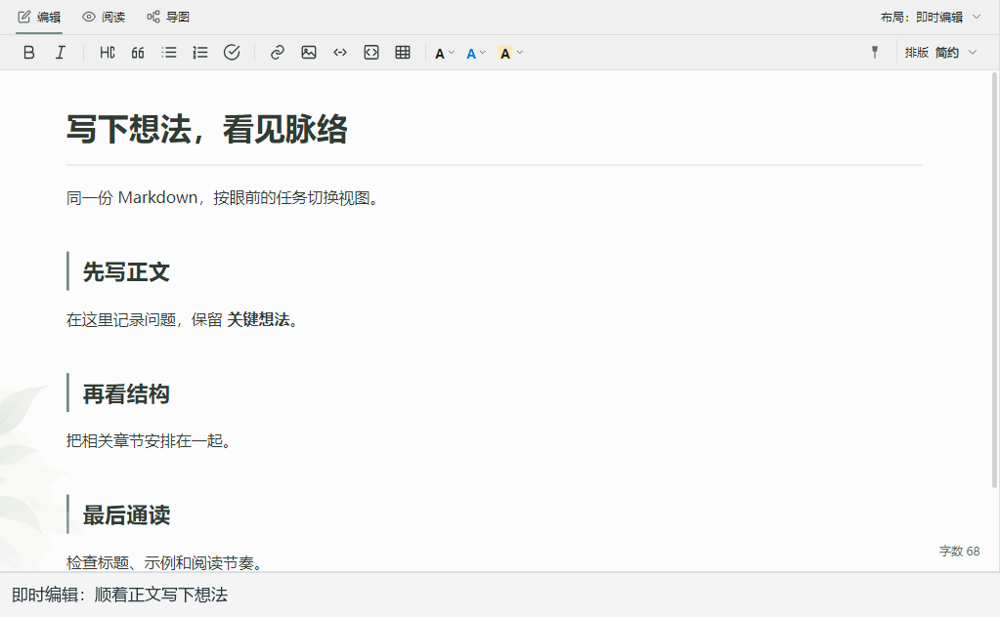

例如写一篇技术方案，可以先在即时编辑里把问题和思路写出来，再用源码与阅读对照检查代码块、链接和格式，最后切到导图，看看“背景、方案、实现、验证”几个部分的安排是否合理。

我更希望这些视图能融入写作过程：卡在一个句子上，就继续写正文；觉得章节绕了，就看结构；怀疑格式有问题，再检查源码。切换的依据是眼前要解决的事情。

### 1.2、八种布局，适应不同的写作节奏


工作区提供八种预设布局，除了四种单视图，还包括“源码 + 预览”“源码 + 导图”“即时编辑 + 导图”和“三视图”。屏幕空间充足时，可以让正文和结构同时出现在眼前；只想专心写一段话时，也可以收起侧栏。

这些组合也有各自适合的时机。“源码 + 预览”方便核对标记与显示结果，“即时编辑 + 导图”适合一边补正文、一边留意章节安排；三视图则把源码、阅读和结构放到同一个工作区，便于集中检查。

布局入口集中在顶部，切换前不必重新打开文章。我自己写长文时，通常先用单视图铺开思路，到整理阶段再把对照视图叫出来，避免屏幕一直被面板占满。

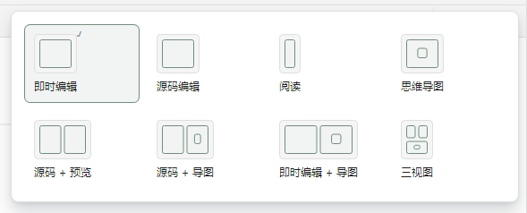

### 1.3、即时编辑，也保留精确控制的入口


这次加入的是**块级即时编辑**：点击正文进入当前块，改完点一下块外任意位置就能完成并收起（键盘流用 `Ctrl+Enter`，`Esc` 取消本块修改），同时保留完整源码入口。


下面直接演示一次：点击已经渲染好的段落，输入“现在补上一句说明。”，按 `Ctrl+Enter` 完成，再点击下一段继续写。原来的加粗文字会保留，操作节奏更接近 Typora 这类编辑器。


这次演进让两种习惯有了各自的位置：平时顺着正文写，需要精确控制时仍能直接面对 Markdown。源码与即时编辑也共用正文撤销历史。

比如一段解释已经写好，只想调整链接地址或代码块标记，就可以回到源码完成。即时编辑负责让日常输入更直接，源码负责让文件里的每个字符都能被检查，两种方式接得上，才方便在同一篇文章里交替使用。

## 2、导图开始参与修改文章


### 2.1、先看骨架，找到文章哪里不顺


长文章写到一半，常会遇到结构问题：一个小节写得太长，应该拆出去；某段解释放早了，读者还没看到前提；两个看似平级的标题，其实有从属关系。

这也是章节导图值得单独介绍的原因。它既能展示结构，也能直接操作章节。

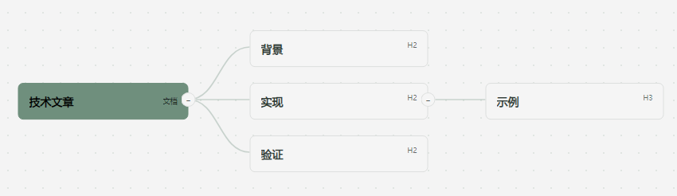

我经常遇到的情况是：每一段单独读都说得通，放在一起却有些绕。把文章压缩成标题和层级后，“前提还没交代就开始讲实现”“同一件事在两个地方重复出现”之类的问题，会更容易被看出来。

### 2.2、从节点操作，直接改到 Markdown


选中节点后，双击或按 `F2` 可以修改标题，`Enter` 新建同级章节，`Tab` 新建子章节。层级和顺序可以通过工具栏、详情面板或拖动调整，移动章节时会带上子章节，删除需要确认，正文修改可以撤销。

这里改动的仍然是文章本身。比如把“实现细节”移到“设计目标”之后，再回到正文，就能继续沿着新的章节顺序写下去。

动图里先把“实现”改成“实现步骤”，再把这一章拖到“验证”后面。节点名称、章节顺序和下面的“示例”子章节一起变化，改动也会写回 Markdown。

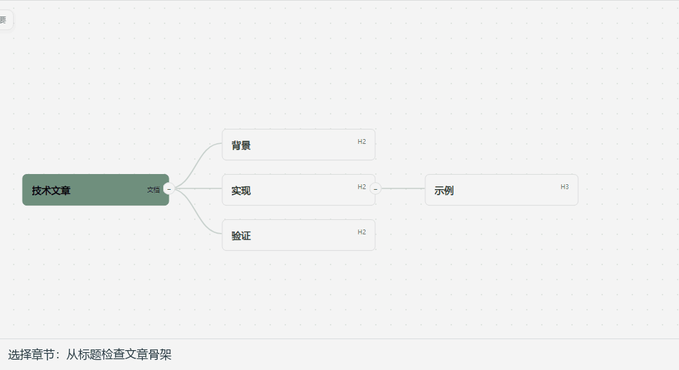

也可以先用 `Enter` 和 `Tab` 搭出章节框架，确定每个部分要回答什么，再逐节补充内容。

### 2.3、调整一个章节，带上它的完整上下文


结构调整最怕只移动了标题，下面的说明、示例和子章节还留在原处。所以，章节操作需要以整段内容为单位，移动时带上所属子章节，删除前确认，再通过撤销给调整留出余地。

对于教程、技术方案、项目总结这类内容，导图提供了一个不同于逐段滚动的检查角度：先看骨架是否成立，再回到段落里打磨表达。

## 3、长文导航：点得过去，也跟得上阅读位置


### 3.1、点击标题，能够落在正确的章节


大纲看起来只是一个标题列表，但它至少要做好两件事：点击标题时带你去对应位置；阅读正文时让你知道自己读到了哪一节。

最近一轮更新，把这两件事重新梳理了一遍。

在阅读预览中，点击大纲可以定位对应章节，已经选中的节点也能再次激活；同名标题会按源码位置区分，离开当前可见范围的标题也可以定位。键盘操作支持 `Enter` 和空格激活。

比如先点“实现”，滚动到别处，再点一次“实现”，仍然应该回到那一节。文章里有两个“注意事项”时，也应该分别对应各自的位置。这些都是很普通的阅读动作，不能只在标题唯一、恰好位于屏幕内时才有效。

### 3.2、阅读位置跟随，保持当前操作节奏


继续滚动正文时，大纲会更新当前章节高亮。这个跟随只更新状态，保持正文焦点；当你正在操作大纲时，它也不会主动把列表挪走。

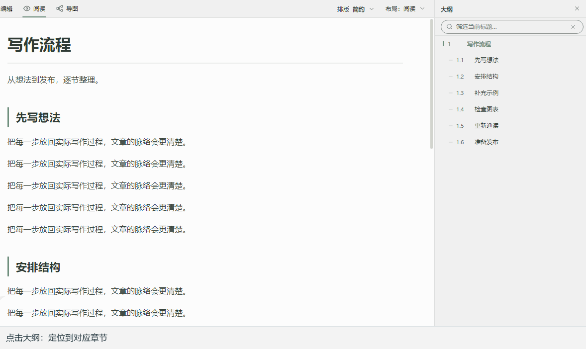

技术文章里的“示例”“注意事项”“小结”很容易重名。这些细节决定了大纲能否成为可靠的路标。

对读者来说，理想状态是偶尔瞥一眼就知道读到了哪里；需要跳转时，大纲再承担导航。高亮变化本身不会变成一次新的跳转，也不该让正在选择或复制的正文突然失去焦点。

### 3.3、讲解长文章时，切到演示模式


需要讲解文章时，还可以按 `F6` 进入演示模式，在正文、大纲和导图之间切换，退出后恢复原来的布局与阅读位置。

演示时可以用 `D / O / M` 切换正文、大纲和导图，用左右方向键或 `PageUp / PageDown` 翻节，按 `Esc` 或 `F6` 退出。讲到实现细节时看正文，交代整体方案时看导图，讲完还能回到刚才写作的位置。

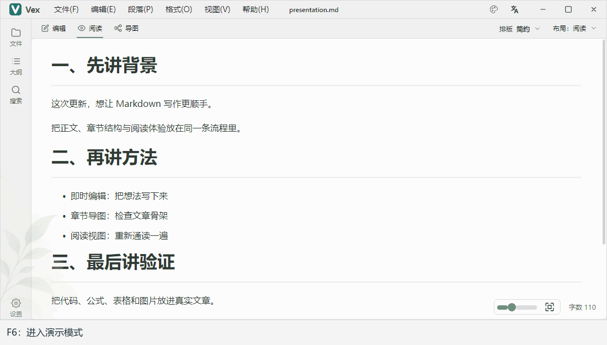

## 4、流程图也能留在正文里修改


### 4.1、点击图表，就地展开源码


写技术文章，代码、公式、流程图经常交替出现。Vex 的 Mermaid 渲染基于 [Mermaider](https://www.nuget.org/packages/Mermaider/)，随包自带图鉴示例。

单击图表或图片时，按当前视图分流：

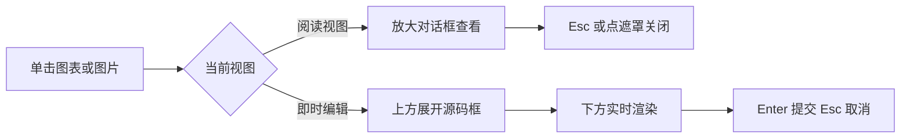

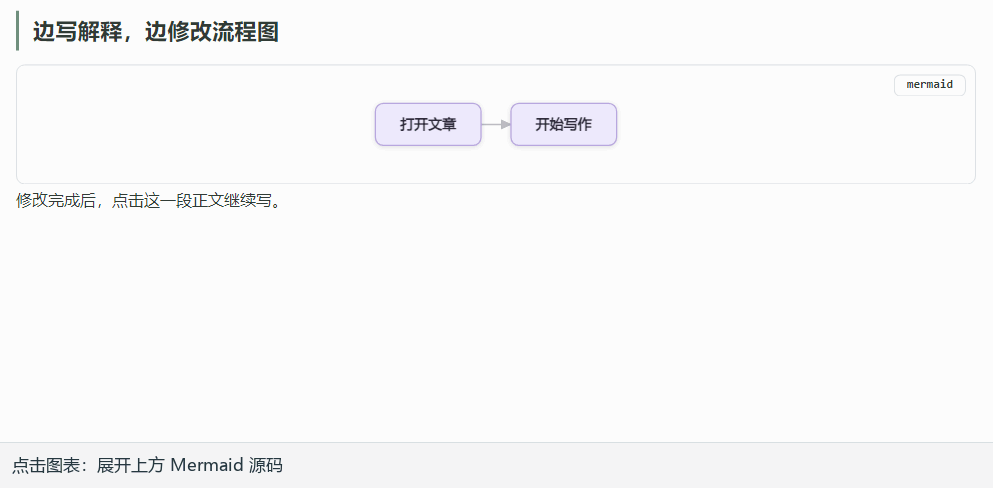

例如正在解释一段处理流程，发现图中少了一条异常分支，可以直接点开这张图，补上 Mermaid 源码，再回到相邻段落继续写。修改的位置和正在阅读的位置挨在一起，更容易保持上下文。

### 4.2、图表与解释，一起留在文章里


对于“边写解释、边调整图”的过程，这种就地修改能减少来回找源码的操作。图表仍然和正文一起保存在 Markdown 中，后续整理、版本管理或继续编辑时，都有对应的文本内容。

上面的例子从两个节点扩展成四个节点，对应的内容仍然只是这段文本：

```text
flowchart LR
 A[打开文章] --> B[开始写作]
 B --> C[整理排版]
 C --> D[准备发布]
```

几周后重新打开文章，或者用 Git 查看前后变化，也能从这段源码继续修改。

### 4.3、图片同样能就地改源码


图片也加入了同一套交互：即时编辑视图里单击图片，图片上方会展开形如 `` 的源码框，改个路径或说明文字，下方图片实时刷新；`Enter` 或点击正文提交，`Esc` 取消。在阅读视图里单击图片或图表，则统一弹出到前文提到的放大对话框。


### 4.4、图、表、公式和代码，都要放回正文检查


公式、代码块、表格和图片也继续作为正文的一部分呈现。复杂内容最终导出到不同格式后，仍应打开目标文件检查实际效果。

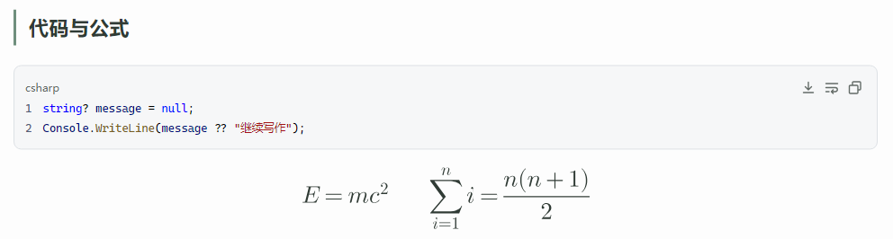

下面沿着同一份示例往下读：代码与公式之后，是表格和任务列表，再往下是两列本地图片。相对路径、图片宽度和表格列宽都放在实际正文里一起检查。

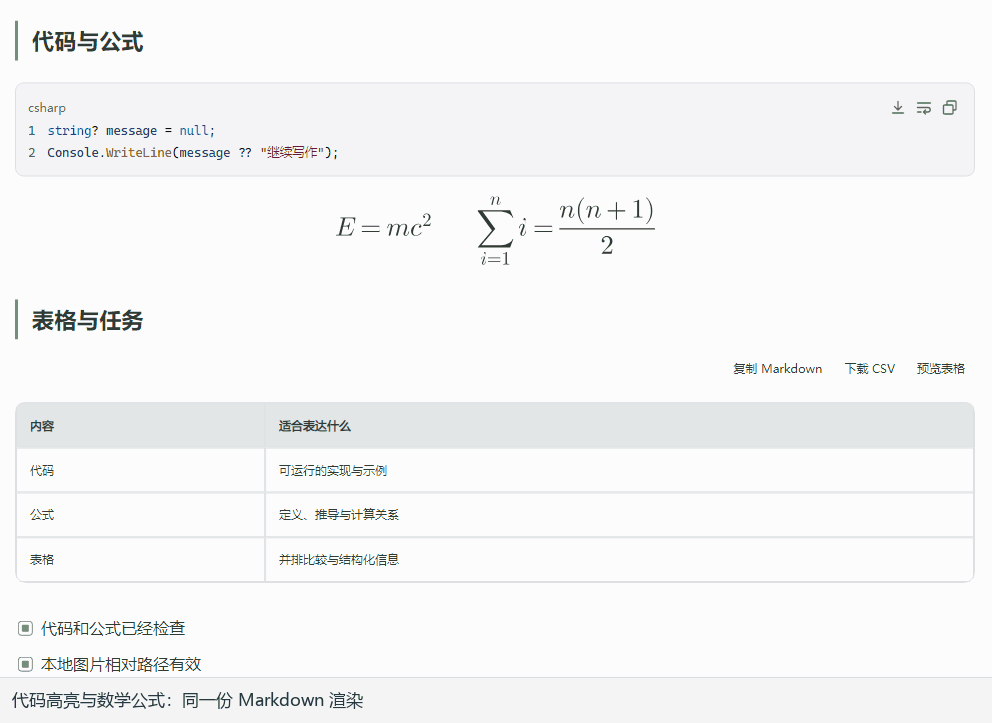

这篇文章本身就提供了一个例子：末尾用两列表格并排放网友的工作截图，整理时发现了表格内图片没有显示的问题。修复后，Vex 的阅读与即时编辑、Vox 的预览都能显示这两张图。用自己的文章走一遍，比单独放一张演示图更容易发现实际问题。

同时，也要区分编辑器里的呈现和发布平台的能力。Mermaid 是否需要转成图片、宽表格在手机上是否好读、图片是否已经上传，仍然要在目标平台检查。

## 5、界面外观和正文排版，各管各的


### 5.1、界面配色和正文排版，分别挑选


这一阶段还整理了外观与排版设置。现在有九套界面配色、十三套正文排版，支持浅色、深色和跟随系统，界面语言包含简体中文、繁体中文、英文和日文。

选择正文排版时，可以直接看效果卡片。换界面配色和调整文章的正文样式，是两件独立的事。

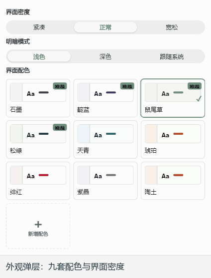

侧栏和菜单适合什么颜色，正文适合什么字号、行距，是两类偏好。我希望换一套界面配色时，已经选好的正文阅读节奏还能保留；挑正文排版时，也能把注意力放在文章本身。

### 5.2、密度和语言，照顾不同的使用习惯


界面密度与正文密度也分别设置：有人希望菜单、侧栏紧凑一点，但正文保留宽松的阅读空间；也有人希望用更大的操作区域。这些偏好不必绑在一起。

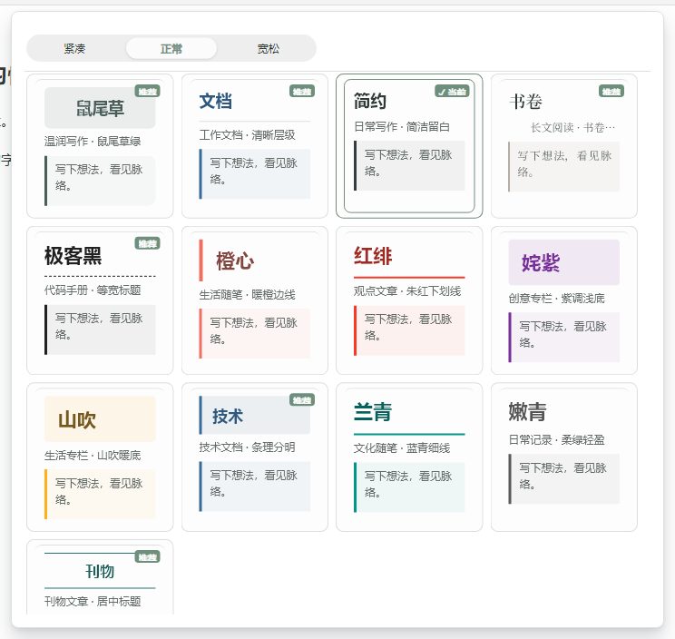

用笔记本写作时，可以让界面紧凑些，把空间留给正文；放到较大的显示器上，再把操作区调得宽松些。四种界面语言也都从同一个入口切换，尽量让设置的组织方式保持一致。

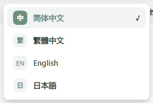

### 5.3、选区样式和菜单，也要经得起日常使用


正文选区还可以设置字号、前景色和背景色，样式会以行内标记保存到 Markdown。使用这类混排时，需要考虑目标平台对标记和样式的支持情况。

例如在一篇说明里突出一句结论，或者给待补充的文字加上背景色，编辑时可以直观看到效果，源码里也能检查对应标记。准备跨平台发布的文章，建议先确认平台是否接受这些样式，再决定保留多少。


菜单也做了细节调整：常规菜单按内容自然测量宽度，同时遵守屏幕边界约束。标题翻译长一点时，尽量让文字完整、单行地呈现。

这些变化很难用一张功能清单表达，但每一次打开菜单、调整字号、切换明暗模式时，都会碰到它们。

## 6、写完正文，还要保留文章的信息


### 6.1、YAML 文件头，是文章的一部分


博客文章往往有一段 YAML 头，记录标题、摘要、日期、分类、标签和封面。它属于文章文件，也需要被编辑器正确识别。

这一轮修复了博客 YAML 头在阅读与即时视图中的解析和显示，元数据会呈现为卡片，分类、标签、日期等信息以及原始分隔符保持完整。

这样打开已有博客文章时，就能区分元数据与正文；需要精确修改字段时，仍可以在源码中查看文件头。

这篇文章采用的也是内嵌 YAML：文件开头用两行独立的 `---` 包住元数据，结束后再写正文。标题、摘要、分类和封面都跟文章放在一起，移动或交给其他工具管理时，不必再寻找另一份同名配置文件。

下面是一份可以直接对照的示例，开头和结尾的分隔符也属于文件内容：

```yaml
---
title: "用 Vex 写一篇技术文章"
slug: vex-writing-notes
description: "正文、结构与阅读，在同一份 Markdown 里"
date: 2026-11-08 17:20:00
categories:
  - Avalonia UI
tags:
  - Markdown
  - Native AOT
draft: true
---
```

从源码切到阅读，再切到即时编辑，效果如下。文件头会呈现为元数据卡片，正文从卡片下面继续；切换视图不会把 YAML 字段改写掉。

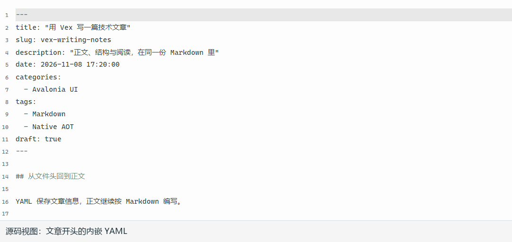

对于已有内容仓库，文章可以继续沿用原来的字段和目录组织。准备发布时，再由内容管理流程检查日期、标签与图片路径。

### 6.2、导出与平台复制，衔接正文之后的工作


写完之后，Vex 支持导出 Markdown、HTML、PDF、PNG 和 Word，也保留了复制到微信公众号、知乎和稀土掘金的入口。

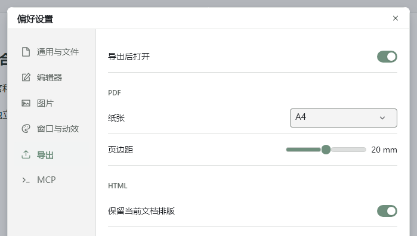

这些导出和复制能力在早期版本里已经存在。这次把它们放回完整流程来看：先把正文写好、结构理顺，再检查排版，最后生成需要的副本，或者复制到平台编辑器中检查呈现。

需要保留可继续修改的原文，就保存 Markdown 和附件；需要发给别人阅读，再按场景选择 HTML、PDF、PNG 或 Word。复制到平台编辑器之后，还要看一遍标题层级、代码块、图片和表格，确认平台过滤样式后仍然清楚。

这里的“复制到平台”是把内容放进剪贴板，再由你粘贴并检查。文章什么时候对外发布，仍然由你在平台上确认。

### 6.3、正式保存、恢复草稿和备份，各有用处


文件保护也在继续完善。自动保存默认关闭，开启后有对应的路径与磁盘基线检查；异常退出草稿用于恢复中断内容。重要文章仍然建议配合 Git 或目录备份保存。

具体来说，未命名的新文档仍需要先手动保存。异常中断后的恢复草稿会先供你查看，再恢复成独立的未保存文档，避免直接覆盖原文件。保存失败时，也需要保留正文和提示，让人有机会重试或另存。

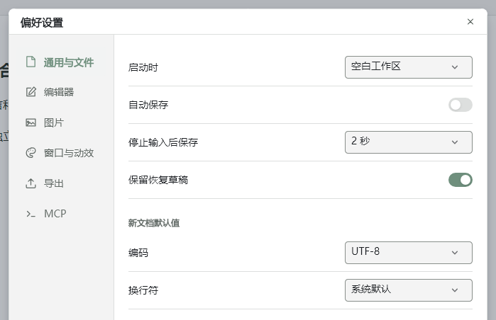

图片采用相对路径时，备份和移动文章还要带上附件目录。对长期维护的技术文章，我仍然会把 Markdown、配图和 Git 记录一起留下来。

## 7、给 .NET / Avalonia 开发者补几句


### 7.1、工程基础，跟上 .NET 与 C# 的演进


Vex 当前主分支使用 .NET 11 和 Avalonia 12.1.6，工程启用了可空引用类型检查

对于文件路径、选区、当前文档、异步加载结果这些随操作变化的状态，可空检查能帮助把边界条件提前暴露出来。允许使用预览语言特性，也需要构建、依赖和实际发布一起跟上，不能只看编辑器里是否没有红线。

### 7.2、大纲的选中状态，要和主动导航分开


这些基础能力之外，这次很有代表性的一个问题，是大纲的“选中状态”与“主动导航”需要分开处理。

滚动阅读引起的章节高亮，如果反过来触发导航，就可能让正文跳动；点击一个已经选中的节点，如果只依赖选中值变化，又可能什么也不发生。两种操作看起来都涉及同一个节点，实际意图却不同。

所以，这里的状态变化需要说明来源：滚动正文是在更新“当前读到哪里”，点击或键盘激活才是在表达“我要去哪里”。把这两个方向分清楚，大纲、正文焦点与阅读位置才能配合起来。

### 7.3、NativeAOT，需要验证真正发布出来的程序


另一个持续检查的方向是 NativeAOT。普通构建运行正常之后，还需要检查原生发布产物中的资源、绑定和序列化路径。最近的 Windows 本机验证包含实际 NativeAOT 窗口、大纲导航与阅读跟随，其他操作系统的人工体验仍需要分别验证。

这一轮也把带有 YAML 和表格图片的实际文章用于运行验证。测试既看源码有没有变化，也看图片是否真的加载、是否占据正确的布局空间。这类问题往往要放进完整窗口、真实宽度和实际文章里，才更容易看清。

### 7.4、MCP 入口，换成官方 SDK 继续服务 AI 写作流程


这一轮把协议层换成了微软官方 [C# SDK](https://github.com/modelcontextprotocol/csharp-sdk)：会话分配、协议版本协商和 Streamable HTTP 传输都归它管，应用内补上了「测试连接」和模拟调用。


已经在用 AI 协助写作的朋友可以继续沿用这条入口，客户端配置不受影响。迁移过程踩到的坑和完整做法，单独写了一篇[《给桌面应用装上 MCP 服务：官方 C# SDK 实战（Vex 为例）》](https://codewf.com/2026/11/dotnet-mcp-csharp-sdk-vex)，这里不再展开。


AI 可以参与整理内容，但文件访问范围、修改确认和事后核对仍然重要。我希望这条入口能和日常编辑并存：自己写的时候顺手，需要协助时再把具体任务交出去。


## 8、接下来，用这套工具写文章


### 1、写完这篇，下一步是 Vox

写作这件事，这篇已经交给了 Vex；管理文章元数据、图片和多平台发布，是下一个开源项目 **Vox · 维声**的目标，它目前还在快速打磨（先行预览版同样开源）。等它成型，我再单独分享两个工具围绕同一份 Markdown 协作的完整流程。

目前先把这篇稿子作为实际样本：在 Vex 中整理表达、检查章节，再交给 Vox 处理文章信息与发布准备。两个工具围绕同一份 Markdown 协作，也方便发现格式、预览和图片处理之间衔接不顺的地方。

### 8.2、第一次体验，建议从自己的一篇文章开始


如果你上次认识的 Vex 还是源码与预览双栏，这次可以试试：打开一篇自己的长文章，写几段正文，到导图里检查结构，再回到阅读视图通读一遍。

不必一开始就把所有设置调完。先看三件事：写正文是否顺手，调整章节是否方便，重新通读时能否很快找到位置。最好选择一篇带标题层级、代码和图片的文章，这样更容易判断它是否适合自己的习惯。

### 8.3、下载、文档和反馈入口


- 项目主页：[github.com/dotnet9/Vex](https://github.com/dotnet9/Vex)
- 官网与使用说明：[vex.codewf.com](https://vex.codewf.com/)
- 下载：[GitHub Releases](https://github.com/dotnet9/Vex/releases/latest)
- 问题与建议：[GitHub Issues](https://github.com/dotnet9/Vex/issues)

## 9、欢迎提 Issue、提 PR，一起打磨 Vex


### 9.1、感谢把真实需求带进项目的朋友


特别感谢 [sunyonghuan](https://github.com/sunyonghuan) 多次提交 PR。除了上篇文章介绍的 [MCP 服务（PR #2）](https://github.com/dotnet9/Vex/pull/2)，这次也采纳了他在 [PR #14](https://github.com/dotnet9/Vex/pull/14) 中关于文件与文件夹加载优化、文件图标解析等方面的贡献：目录按需加载，文件类型也有了更直观的图标。下面两张图是他使用 Vex 整理工作文档的截图，从浅色工作区到深色架构文档，这些真实使用场景也在帮助 Vex 继续改进。

| 浅色工作区与视图选择 | 深色工作区与架构文档 |
| --- | --- |
| 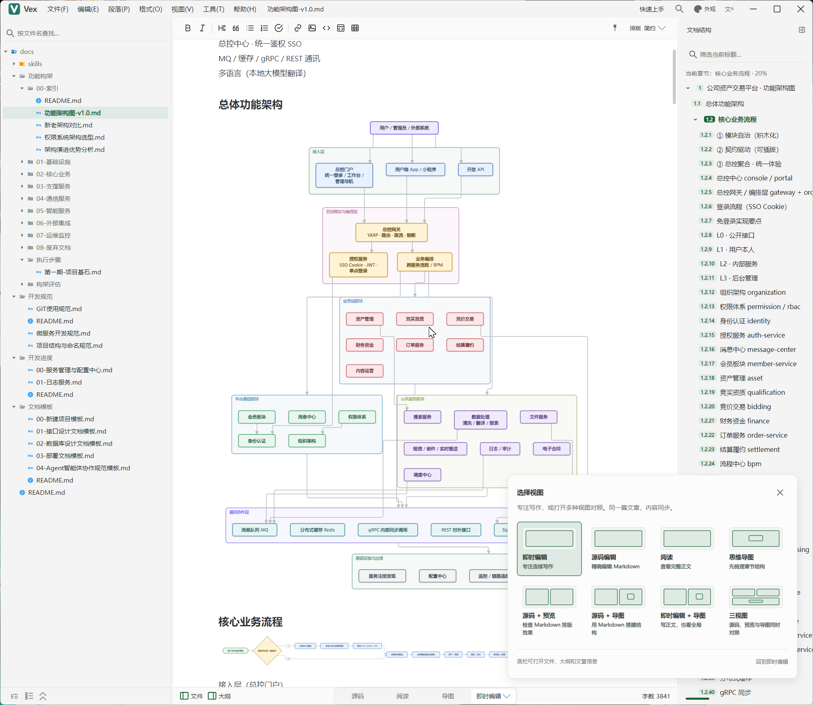 | 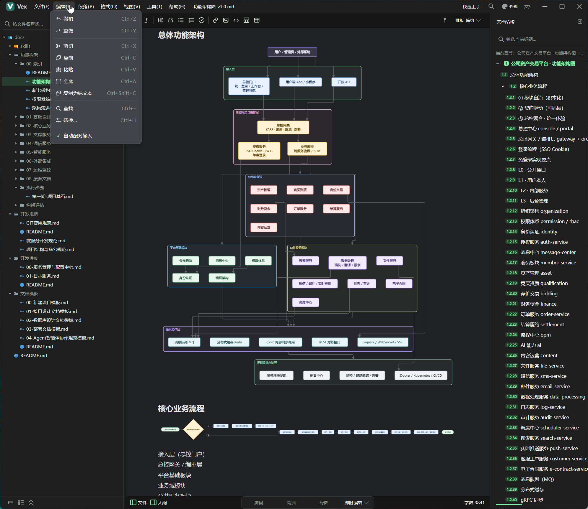 |

### 9.2、提 Issue 时，带上具体的使用场景


Vex 还有不少值得打磨的地方。你在写长文章时，最常被哪个环节打断？欢迎通过 [Issue](https://github.com/dotnet9/Vex/issues) 分享具体文档、复现步骤或功能建议，也欢迎提交 [PR](https://github.com/dotnet9/Vex/pulls)，一起修问题、补文档、完善翻译，或改善日常写作中的一个小细节。

如果遇到显示或操作问题，可以说明操作系统、Vex 版本、使用的视图，以及“做了什么、预期怎样、实际怎样”。能够复现的小段 Markdown、截图或动图会很有帮助；分享样本前，也请先去掉工作文档中的敏感内容。

### 9.3、从一个小 PR 开始，一起改善日常体验


一个翻译补全、一段文档说明、一处文件图标，或者一条能稳定复现问题的测试，都有实际价值。如果准备调整较大的交互，也欢迎先在 Issue 里聊聊使用场景，再一起确定改动范围。

像 sunyonghuan 这样，把工作中真正遇到的问题带回来，再一步步改进，正是我很期待的协作方式。希望 Vex 能在大家的日常使用和反馈中，慢慢成为更顺手的写作工具。
