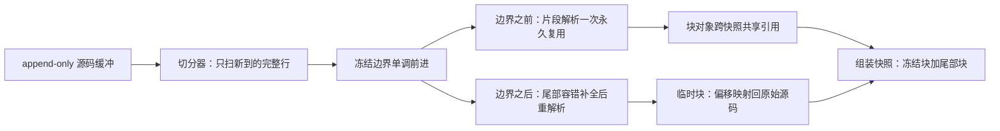
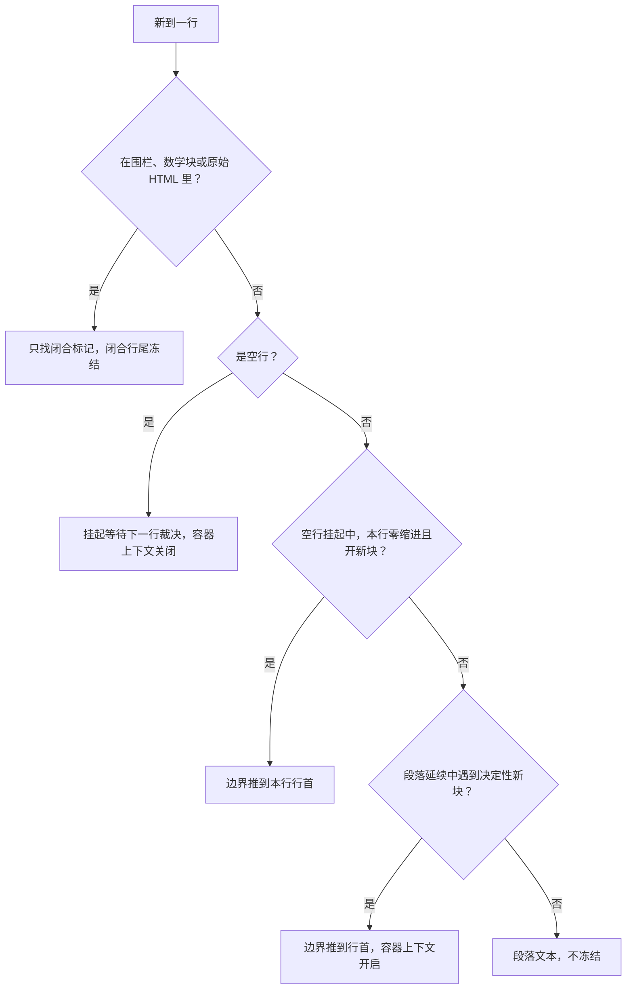
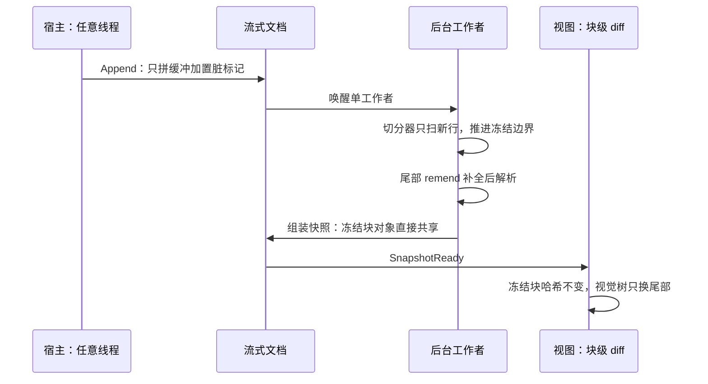
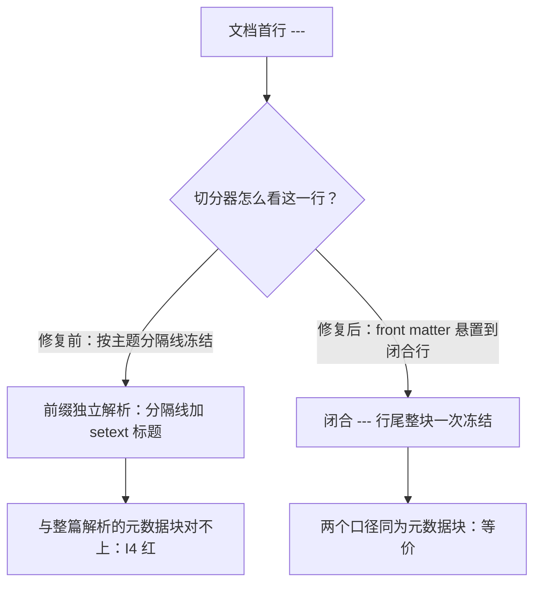

上一篇[《Markdown 编辑器每键 22× 提速：脏块回写替代全文序列化》](https://codewf.com/2026/11/vex-editor-dirty-block-writeback)砍的是编辑器的回写端，这一篇补上解析端的另一半：AI 逐 token 输出 Markdown 时的流式渲染。

场景很常见——聊天窗口里 AI 的回答一个 token 一个 token 地往外蹦，每次到达都带着一小段新的 Markdown。多数实现的做法是把全文拼起来重新渲染一遍：20KB 的回答流完，就是五千多次整篇解析。我按这个朴素成本模型测了一下：20KB 文档按 4 字符一个 token 流完，5141 步总共 4.6 秒、4.8GB 内存分配——都在流式输出期间发生，用户正盯着屏幕看字往外蹦的时候。

这篇讲 Vex 的流式渲染内核怎么把这两笔账砍到 26ms 和 103MB，冻结边界的规则怎么定，以及"流式中间结果必须和整篇解析完全一致"这条底线怎么测试——它还真抓出了一个 front matter 的冻结缺陷。

## 1、朴素实现贵在哪

先看每 token 一遍的完整账单：


两处浪费叠在一起。一是 [Markdig](https://github.com/xoofx/markdig) 解析 20KB 文档要 2~3ms，5141 步乘出来就是秒级；二是每步都要 `substring` 一个前缀再整篇解析，分配随步数平方级堆——4.8GB 就是这么来的。Vex 现有管线的块级 diff 已经做得不错（哈希不变直接复用视觉树），但基准里一拆账，diff 只占步均耗时的 1%，剩下 99% 全是解析。**diff 救不了解析**：优化得再好的比对，也架不住每步都重新算一遍输入。

方向于是很明确：别整篇算。可追加型输入有一个朴素实现没利用上的性质——**前面的内容永远不会变**。

## 2、冻结边界：给前缀开一张"不再变更"证明

内核的输入是一个只追加（append-only）的源码缓冲，它是唯一真相。在上面定义一个位置：

> **冻结边界**：边界之前的前缀，无论之后到达什么文本，解析结果都不会再变。

边界单调前进。边界之前的片段各自解析一次，产出的块对象跨快照直接共享引用；边界之后的尾部每步重解析，是唯一"活"的部分：



这个结构的收益分两层。解析层：每步只解析"上次边界到现在"的增量片段加一个短小的尾部，成本与文档总长解耦。渲染层：冻结块的哈希不变，视觉树一个都不用重建，只有尾部块走替换——和上一篇文章的脏块回写在渲染端殊途同归。

剩下的全部难点聚成一个问题：**边界怎么定？**

## 3、冻结边界：一行一行地判决

边界定错方向只有两种犯错方式：误冻结（把"以后还会变"的内容提前定型，结果错了）和漏冻结（保守不动，只是多算一点）。这条不对称性决定了整个切分器的设计姿态——**所有识别都朝漏冻结的方向犯错**：漏冻结只损失性能，误冻结破坏正确性。

切分器逐行扫新到的文本，几种判决规则按优先级排：

| 规则 | 触发 | 冻结点 | 为什么 |
|---|---|---|---|
| 显式闭合 | 围栏闭合行、`$$` 闭合、ATX 标题、分隔线 | 该行行尾 | 这些行完成即定型，标题不允许延续 |
| 空行规则 | 空行 + 下一行零缩进且开新块 | 下一行行首 | 空行是顶层块的标准分隔，但要确认下一行不延续前块 |
| 决定性新块 | 段落延续中遇到 `- `、`> `、`1. `、围栏开启 | 该行行首 | 首字符已唯一决定"新块开始"，追加什么都不会推翻 |
| 未完成行前缀 | 行没扫完，但已到的前缀具备决定性 | 该行行首 | 流式场景行尾永远来得很慢，不能干等换行 |

看着简单，坑全在例外里。几条最费心思的：

**空行的七个条件。** 空行不是万能分隔符：围栏代码块里的空行（围栏没闭合）、松散列表的空行（`- a` 空行 `- b` 是同一个列表）、引用的空行（`> a` 空行 `> b` 还是同一个引用）、缩进行的空行（可能是缩进代码续行），都不能冻结。漏掉任何一条就是误冻结。

**lazy continuation 抑制。** [CommonMark](https://commonmark.org/) 的懒续行规则会让容器开启后的"顶层样式行"继续吞进容器：`> a`、`b`、`===` 三行是一个引用里的 setext 标题，不是"段落加标题"。所以容器开启期间，setext 下划线和决定性新块冻结一律抑制，只有围栏/标题/分隔线这类能打断容器的结构仍可识别——而且只认零缩进。

**未完成行的前缀判决。** 流式输出时最后一行永远没有换行符，如果只信完整行，边界就永远停在上一行——尾部会越积越大。所以前缀本身具备决定性时也要能冻结：`- ` 后面不管来什么字都是列表项，边界直接推到行首；但光一个 `-` 不行，它可能是 setext 下划线的第一个字符，会把上一段落改写成标题。数字序列同理：`123` 可能是任何段落的开头，`123. ` 才是有序列表。判决只用已到达的字符，且追加任何文本都不可能推翻。

一条空行规则的主干判定，画出来是这样的：



完整的规则表（含 front matter、HTML 原始块、全部前缀形态）在 Vex 仓的 `docs/流式规则.md`，规格先行——规则表里的每一条都对应至少一个测试用例。

## 4、尾部容错：半截语法也要像样

边界之后是用户正在看的"半截文本"。刚敲出 `**加粗` 的时候，如果直接送去解析，星号按奇偶配对失败就渲染成字面量，用户会看到一行突兀的 `**`，下个 token 到达又突然变粗体——闪一下，再闪一下。

思路是先把尾部**补全成合法形态再解析**：这正好是 Vercel 在 [streamdown](https://github.com/vercel/streamdown) 里解决过的问题，他们后来把这部分拆成了独立的 [Remend](https://vercel.com/changelog/new-npm-package-for-automatic-recovery-of-broken-streaming-markdown) 包。我借鉴它的思路（补全思路自研，没有跟它的实现），按优先级排了一组处理器：

| 优先级 | 处理器 | 补全动作 |
|---|---|---|
| 10 | 未完成链接 | `[text](url` 补 `)`；`[text` 补占位地址 |
| 20 | 强调 | `**`、`*`、`__` 按奇偶补齐闭合符 |
| 30 | 行内代码 | 反引号奇数个补一个 |
| 40 | 数学块 | 未闭合 `$$` 补闭合（行内单个 `$` 不碰："价格 $5" 误报成本高于收益） |
| 45 | setext 歧义 | 段落后的半个 `-` 会被当标题下划线，插零宽空格打破 |
| 50 | 未闭合围栏 | 末尾补闭合围栏后正常解析 |
| 60 | 半截 HTML 标签 | `<di` 这种剥掉再解析 |

有个最高频的形态值得单独开小灶：**AI 回答流式代码块**。尾部以围栏开启行开始且尚未闭合时，补全加 Markdig 解析全是白费——直接按围栏规则手工构造代码块，每步只做行切分和字符串拼接，不建 Markdig 文档、不做字符级配对扫描。

补全有个隐藏代价：插入的字符让 Markdig 报告的块偏移漂移了。块在源码里的起始偏移是它的稳定 key（选区、UI 状态都挂在上面），所以每次补全都记一张插入点账，解析完用双指针把块偏移映射回**原始源码坐标**。映射不上的块（补全改变了块结构）整块标记临时态，下个快照自然修正。还有一条铁律：**补全只作用于临时文本，绝不写回源码缓冲**——缓冲里的半截语法是真相，补全是表演。

整个内核的一次心跳：



## 5、等价性是底线，也是抓 bug 的网

增量系统最容易死在"中间态悄悄和全量态不一样"上。所以这个内核的验收标准从第一天起就是一条不变量（规格里编号 I4）：

> 对任意快照，`[0, 冻结边界)` 区间按片段解析得到的块序列，必须与整篇解析这个前缀得到的块序列**完全一致**（块类型 + 源码区间 + 内容哈希）。

配套的等价性测试用任意分片驱动：同一篇混合文档（标题/段落/列表/表格/代码/引用/任务/数学/懒续行，CRLF 和 front matter 单列），分别按 1、3、7、32、500 字符切片再加固定种子随机切片逐 token 喂进去，**每一步快照**都断言 I4、边界单调、冻结块对象跨快照 `Assert.Same`，最后 `Complete()` 之后断言终局与直接整篇解析一致。

这张网真抓到了一条鱼。自测第一批跑下来，front matter 文档红了：**文档首行的 `---` 被切分器按主题分隔线冻结了**。可整篇解析里，`---`、它下面的 `title: ...`、再到闭合的 `---`，是同一个 YAML front matter 元数据块。同一个前缀，两个口径给出不同的块序列：



根因是 front matter 是个"意义取决于后文"的结构：单看首行的 `---`，谁也说不清它是分隔线还是元数据的开头。修法照着"所有识别朝漏冻结方向犯错"的老姿态来——文档首行 `---` 视为 front matter 候选，**悬置一切冻结直到闭合行**，闭合行行尾整块一次冻结。闭合行永远不来（真是篇以分隔线开头的怪文档）也只是整篇留在尾部，等价性毫发无损。规格先改（`docs/流式规则.md` §3.2 F5），再改代码，回归用例当场钉住。

写增量算法的人迟早都会遇到这条鱼：**逐块判决的逻辑，和整体语义之间总有几个"单个看怎么都对、合起来就不是它"的灰区**。等价性测试不是摆设，它是唯一能把灰区照亮的东西。

## 6、数字

基准 harness 与等价性测试一起入库（`MarkdownStreamingBench`），Windows 11 x64 / .NET 11 Release，等价性断言随基准钉住（两条路径跑完的终局必须一致）：

| 场景 | 每 token 整篇重解析 | 流式内核 | 提升 |
|---|---|---|---|
| 20KB 混合文档 / 4 字符 token / 5141 步 | 4606 ms，分配 4826 MB | **26 ms，分配 103 MB** | **177× 提速，47× 降分配** |
| 50KB 单代码块 / 4 字符 token / 12808 步 | 7252 ms，分配 14.1 GB | **104 ms，分配 724 MB** | 70× 提速，19× 降分配 |

第二行就是围栏快速路径的战场——AI 回答里最典型的"一大段代码流式输出"，常规补全解析路径要 14.1GB 分配，快速路径 724MB。内核当年在外仓落地时（.NET 10，另一台机器）登记的是 42×/24×，绝对值不可比，倍数口径一致；这台机器上的朴素基线更慢，倍数相应更夸张，但量级结论一样：**逐 token 整篇重解析这个做法，在流式场景里没有活路**。

残余成本也交代一下：流式侧的 103MB 主要来自每次 `Append` 的字符串拼接和尾部临时解析，量级已经与文档大小相关而与步数无关；墙钟含 1ms 轮询粒度。内核目前只在库里（含突发分片整形的节奏器），Vex 应用侧的消费端——AI 面板接 `StreamingSource`——排在下一步。

顺带交代同赛道的选择。开源社区里还有一个思路几乎一致的实现：[StreamMark](https://github.com/AtomUICommunity/StreamMark)（MIT 协议），为 AI 会话客户端而生的 Avalonia 流式 Markdown 渲染器，同样是"已稳定块冻结只解析一次、未完成语法流式修复"的路子，外加全自绘（不依赖 WebView）、LaTeX/Mermaid/TextMate 高亮和 NativeAOT 安全，近期已并入 [TKCode.Arc](https://github.com/AIDotNet/TKCode.Arc) 随其发布维护。Vex 自己的配套控件继续自用，本文的内核也照旧独立演进；如果你在搭 AI 会话界面、不想从内核造起，StreamMark 是现成的整装方案——两个项目都是 MIT，按需取用。

## 7、落到 C#：几个能搬走的细节

这套内核没什么黑魔法，语言层面的几个选择倒是每个都值得单独说。

### 7.1、string 不可变性：O(n²) 的元凶和它的测量

`current = string.Concat(current, token)` 这行代码看着人畜无害，但 string 不可变，每次都把整篇拷进新对象——20KB 文档 5141 步，光拼接就拷了半个 GB 量级，`Substring` 前缀同理。分配不会立刻让你疼（GC 会收），但 Gen0/Gen1 的压力全落在流式进行中，UI 线程卡顿往往就是这些"看不见的拷贝"。

测量分配别靠猜，两个 API 组合够用了：

```csharp
var start = GC.GetTotalAllocatedBytes(precise: true);
var sw = Stopwatch.StartNew();
RunScenario();
sw.Stop();
var allocated = GC.GetTotalAllocatedBytes(precise: true) - start;
```

`GC.GetTotalAllocatedBytes(precise: true)` 是进程启动以来的**累计分配字节数**（不是当前占用），前后一减就是这段代码的分配总量；耗时用 `Stopwatch.GetElapsedTime(startTimestamp)` 拿 TimeSpan，避免自己拿毫秒数做减法丢精度。

### 7.2、record 加引用共享：最便宜的结构共享

冻结块跨快照共享靠的不是缓存字典，就是 C# record 的两个特性：

```csharp
public sealed record MarkdownDocumentBlock(
    Block SyntaxBlock, MarkdownTextSpan SourceSpan, /* ... */ ulong ContentHash, string SourceText);

// 冻结时只需改偏移两个字段，其余原样携带：
_frozenBlocks.Add(block with { SourceSpan = newSpan, PlainTextSpan = newPlain });
```

`with` 表达式做非破坏性更新，产出的是新记录但引用类型字段全部按引用携带。块对象一旦冻结就不再有人写它（append-only 结构保证），于是"同一对象跨快照复用"不需要任何同步——不可变性在这里换来的不是线程安全的教条，而是**渲染层敢直接用 `ReferenceEquals` 加哈希判断"这块没变、视觉树不动"**。测试里专门有一条 `Assert.Same` 钉住这件事，防止哪天有人把共享改成了拷贝。

### 7.3、置脏标记替代队列：渲染场景的天然背压

token 到达是突发的，一帧可能来几十个。排队会让工作者追着中间版本跑，实际上用户只关心最新：

```csharp
lock (_gate)
{
    _source = string.Concat(_source, text);
    _dirty = true;          // 解析中再到达：也只置脏，不排队
}
// 工作者循环：取走 source 与 complete，清脏标记，解析；
// 解析期间新到的文本把脏标记再次置起，下一轮只看最新缓冲。
```

队列是"一个都不能丢"的语义，渲染是"只留最新"的语义——后者的正确数据结构就是一个布尔加一把锁。这一处选择省掉的中间快照，比任何解析优化都直接。

### 7.4、不变量测试：增量算法的唯一保险

上一篇文章结尾我写过"性能验证和行为验证是两件事"，这次再补一刀：增量算法的行为验证只能靠**不变量 + 任意分片**。单看几个手写场景，front matter 那个 bug 大概率漏网——逐行看每一行都判得对，合起来整体语义就不是它。固定种子的随机分片让失败可复现，每步断言让第一个出错的快照直接指认罪魁，这套模式往任何增量系统上套都成立：diff 引擎、撤销栈、协同编辑，都一样。

回头看，这次优化能立住，靠的不是多聪明的数据结构，而是先回答了一个更根本的问题：**凭什么说前缀不会再变？** 记忆化的难点从来不是"把结果存起来"，而是证明"输入不会再变"——冻结边界就是给前缀开具的那份不可变性证明，证明到手，缓存永久合法。

## 参考

- [Markdig](https://github.com/xoofx/markdig)：.NET 速度最快、功能最全的 Markdown 解析库
- [vercel/streamdown](https://github.com/vercel/streamdown)：面向流式优化的 React Markdown 渲染器
- [Remend：Vercel 的流式 Markdown 残缺语法修复包](https://vercel.com/changelog/new-npm-package-for-automatic-recovery-of-broken-streaming-markdown)
- [StreamMark](https://github.com/AtomUICommunity/StreamMark)：为 AI 会话而生的 Avalonia 流式 Markdown 渲染器（MIT，已并入 TKCode.Arc）
- [CommonMark Spec](https://commonmark.org/)：懒续行（lazy continuation）与块结构的权威定义
- [《Markdown 编辑器每键 22× 提速：脏块回写替代全文序列化》](https://codewf.com/2026/11/vex-editor-dirty-block-writeback)：本篇的姊妹篇，砍的是回写端
